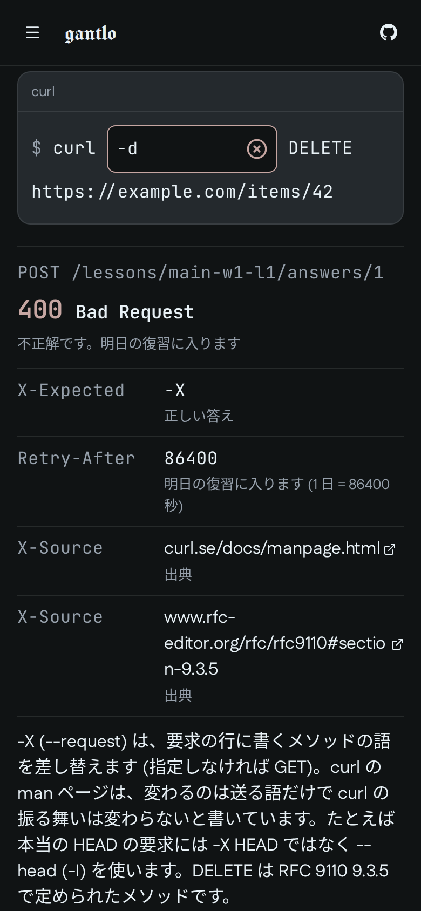
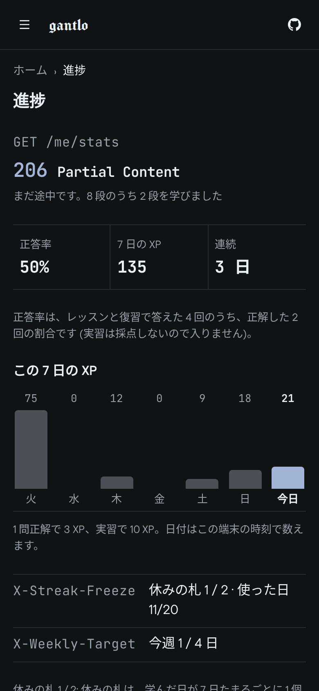
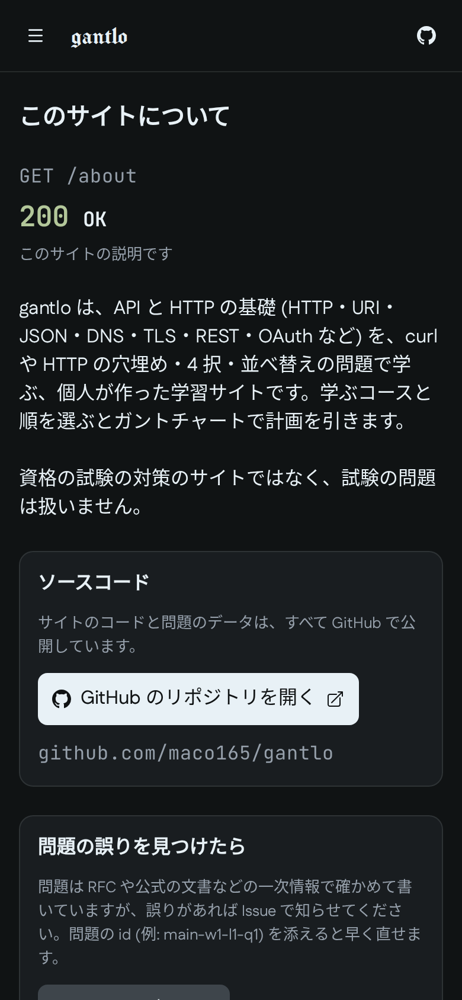
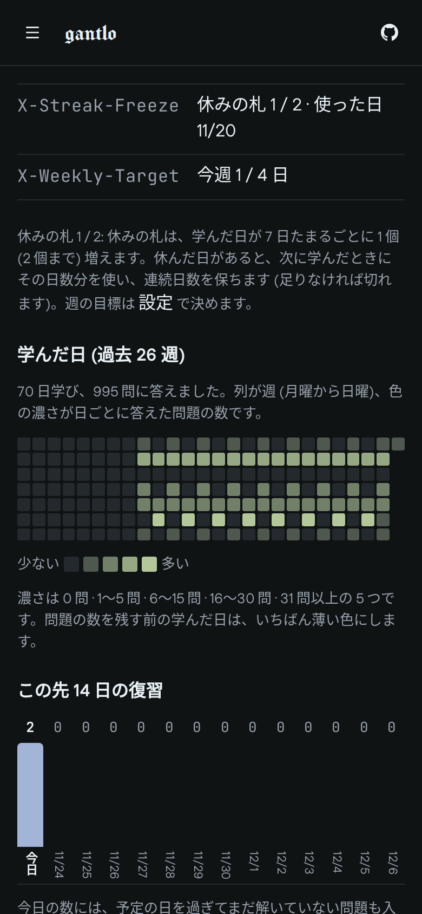
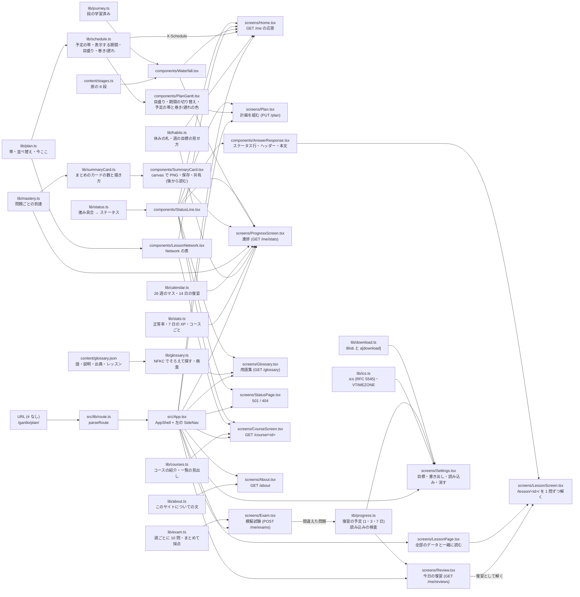
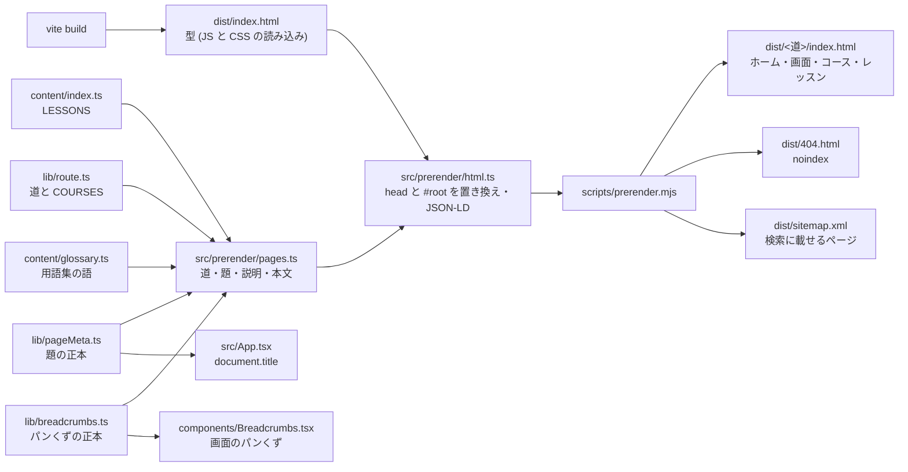

<picture>
  <source media="(prefers-color-scheme: dark)" srcset="docs/images/banner.png">
  
</picture>

**gantlo** は、API と HTTP の基礎 (HTTP・URI・JSON・DNS・TLS・REST・OAuth) を、curl や HTTP の穴埋め・4 択・並べ替えの問題で学ぶ学習サイト。学ぶコースと順を選ぶとガントチャートで計画を引き、画面を見るたびに HTTP のステータスコードとヘッダーに触れる。間違えた問題は日をおいて復習に出し、本編 4 週の総まとめに模擬試験 (40 問・60 分・合格の目安 75%) を置き、問題に出る語は一次情報の出典つきの用語集にまとめる。進捗はブラウザの localStorage にだけ残し、サーバーは持たない。名前は、ガントチャート (Gantt) と、1969 年に ARPANET で最初に届いた 2 文字「lo」から取った。

| | |
|---|---|
| サイト | https://maco165.github.io/gantlo/ (サイト名と副題の正本は `src/lib/site.ts`) |
| 見た目 | Meta の [Astryx](https://github.com/meta/astryx) の **Gothic** テーマ (`@astryxdesign/theme-gothic`)。暗い画面だけ |
| 管理 | [AI-Repository](https://github.com/maco165/AI-Repository) の PJ-029 (要件と backlog は `projects/PJ-029-api-basics/design/`) |

この README は設計書を兼ねる。作りを変えたら、同じ PR でここと図と画像を直す (画像は `npm run readme:images`)。帯の画像は Gothic が暗い画面だけなので 1 枚 (`docs/images/banner.png`) にし、明るい表示の GitHub でも同じ画像を出す。

## 画面

<table>
  <tr>
    <td width="33%"></td>
    <td width="33%"></td>
    <td width="33%"></td>
  </tr>
  <tr>
    <td>ホーム。進み具合をステータスで返し、旅の 8 段を開発者ツールのウォーターフォールの形で見せる</td>
    <td>計画。学ぶコースと順・開始日・目安の日数を決めると予定の帯を引き、巻き・遅れを出す</td>
    <td>穴埋めの不正解は <code>400 Bad Request</code>。正しい答え・翌日の復習・出典をヘッダーの形で出す</td>
  </tr>
</table>

<table>
  <tr>
    <td width="25%"></td>
    <td width="25%"></td>
    <td width="25%"></td>
    <td width="25%"></td>
  </tr>
  <tr>
    <td>並べ替え。上下のボタンで動かし、正しい順なら帯が階段になる</td>
    <td>復習。間違えた問題を翌日・3 日後・7 日後に出す</td>
    <td>進捗。正答率・7 日の XP・コースごとの済んだレッスン</td>
    <td>用語集。11 の規格と問題に出る語を、RFC などの出典つきで</td>
  </tr>
</table>

<table>
  <tr>
    <td width="25%"></td>
    <td width="25%"></td>
    <td width="25%"></td>
    <td width="25%"></td>
  </tr>
  <tr>
    <td>メニュー。左から開き、「このサイトについて」と「GitHub のリポジトリ」は下端に留める</td>
    <td>このサイトについて。ソースコード・誤りの知らせ方・記録の置き場所・ライセンス</td>
    <td>コース。そのコースのレッスンを順に並べ、済みの印と次のレッスンへのボタンを出す</td>
    <td>学び続ける仕組み。休みの札・週の目標・26 週の学んだ日・14 日の復習</td>
  </tr>
</table>


## 見せ方

サイト全体を 1 本の HTTP のやり取りに見立てます。画面を見るたびにステータスコードとヘッダーに触れるので、見ること自体が復習になります。

| 場面 | 見せ方 |
|---|---|
| ホーム | `GET /me` への応答。進み具合はステータス (`202` まだ / `206` 途中 / `200` 全部済み) で、記録はレスポンスヘッダーの形で読む。休みの札は `X-Streak-Freeze` (`休みの札 n / 2`・次に学んだときに使う数・使った日)、週の目標は `X-Weekly-Target` (`今週 n / 目標 日`。週は月曜から。目標を決めていなければ決める場所を添える)。計画の予定と比べた巻き・遅れは `X-Schedule` (例: `408 2 日遅れ`)。計画を一度も保存していないうちは `204 計画なし`。次のレッスンへのボタンは何をするかを日本語で書き (まだ 1 つも済ませていなければ「最初のレッスンを始める」、ほかは「次のレッスンを始める」)、その後ろに HTTP の形 `GET /lesson/<id>` を添える (コース・計画のボタンも同じ。`src/components/LessonStartLink.tsx`) |
| リクエストの旅 | 開発者ツールのウォーターフォール。URL を打ってから画面が出るまでの 8 段を、階段の帯で並べる。段に紐づくレッスンを 1 つでも終えた段は学習済みで、済んだ割合だけ帯を塗る (全部済めば `200`、途中は `206`) |
| レッスン | 答えを送るボタンは `POST 答えを送る`。結果はレスポンスとして出す: 正解 `200 OK` (`X-XP`・`X-Source`・解説)、不正解 `400 Bad Request` (`X-Expected`・`Retry-After: 86400`・`X-Source`・解説)、メディアタイプの空欄の誤り `415 Unsupported Media Type`、並べ替えの順の誤り `409 Conflict` (「N 行が違う位置です」)。答えたあとの解説の下 (AI に聞くリンクの次) に「誤りを報告 (GitHub)」を置き、題と本文に問題の id・レッスン・レッスンのページの URL を入れた GitHub の新しい Issue を新しいタブで開く (自分の答えや記録は入れない。模擬試験の途中は解説を出さないので置かない) |
| 並べ替え | 上下のボタンで行を動かす (ドラッグに頼らない)。確かめると、並べた順の行ごとに、その項目の正しい位置へ帯を描く。正しい順なら帯が階段になり、違う位置の行は誤りの色になる |
| レッスン完了 | `201 Created`。`Location: /me/lessons/<id>` と、結果の JSON (`lesson`・`correct`・`total`・`xp`) |
| レッスンの一覧 | 開発者ツールの Network タブ。レッスン 1 つが 1 行 (Name・Status・形・Waterfall) で、学ぶ順に並べた Waterfall の列が 1 本のガントチャートになる。済んだ行は `200 完了`、計画の順で最初の未完了の行が「次」 |
| コース (`/gantlo/course/<id>/`) | `GET /course/<id>` への応答。ステータスはホームと同じ決まりで、数えるのはそのコースのレッスン (`202` まだ / `206` 途中 / `200` 全部済み。レッスンがまだ無いコースは本文の無い `204 No Content`)。コースの紹介・次のレッスンへのボタン (このコースで 1 つも済ませていなければ「最初のレッスンを始める」、ほかは「次のレッスンを始める」と `GET /lesson/<id>`)・そのコースのレッスンだけの Network の表 (済んだ行は `200 完了`、最初の未完了の行が「次」)。見出し・紹介・一覧の順は書き出す HTML と同じ |
| 計画 (`/gantlo/plan/`) | 学ぶコースを選び、上下のボタンで順を並べ、開始日とコースごとの目安の日数 (既定は 1 レッスン 1 日) を決めると、WBS のように開始日から学ぶ順に予定の帯を引く。横の軸は日付で、帯の上に週の頭 (月曜) と月の境 (1 日) の目盛りを出し (狭い幅では字が重ならないよう間引く)、今日に縦の線を引く。表示する期間は `全体`・`2 週`・`1 か月`・`指定` (始まりと終わりの日。2 年 = 731 日まで) から選べ、期間の外にはみ出す帯は端で切る。選んだ期間は設定 (`profile.ganttView`) にすぐ残る。済んだ量を今日の予定と比べ、`GET /plan/schedule` の応答で巻き (`200 OK`「N 日巻き」、情報の色の青)・予定どおり (`200 OK`、成功の色の緑)・遅れ (`408 Request Timeout`「N 日遅れ」、誤りの色) を出し、済みの塗りも同じ色にする。色だけに頼らず、凡例とステータスに字でも書く。目安の日数に範囲外の値を打つと「1〜365 の整数」と知らせ、既定と同じ値は直した値として残さない。予定は目安で、期限・取り戻し方・通知は持たない。`PUT この順で学ぶ` で保存すると `200 OK`。帯に済んだぶんを塗り、「今ここ」を縦の印で示す。計画が無いときは全コースを既定の順 (本編 → 追加のコース) で見せる |
| 復習 (`/gantlo/review/`) | `GET /me/reviews?due=today` への応答。今日の復習があれば `200 OK` と問題の一覧、無ければ `204 No Content` と次の予定。解き終えると `200 OK` (レッスンの記録は作らないので `201` にしない) |
| 模擬試験 (`/gantlo/exam/`) | `GET /exam` への応答 (`200 OK`)。本編 4 週の採点する問題 (実習を除く) から各週 10 問ずつ 40 問を開くたびに選び直し、60 分で解く。解いている間は正誤 (応答の枠) と AI に聞くリンクを出さず、`POST 答えを送って次へ` で次の問題へ進む。問題の下に「前の問題」「次の問題 (答えずに)」「あとで見直す」(押した状態を `aria-pressed` で伝える印)「一覧と採点へ」と、問題番号の一覧 (番号ごとに未回答・回答済み・印を字でも書く) を置き、好きな問題へ移れる。答えた問題へ戻ると「送り直すと前の答えを置き換えます」と出す (残しているのは正誤とコードだけなので、入れた答えは出せない)。最後の問題のあとは、すぐに採点せず `POST /me/exams (Expect: 100-continue)` の `100 Continue` で採点の前の確かめ (`X-Unanswered`・`X-Marked`) を出し、`POST 採点する` で採点する。上の帯に残り時間 (残り 5 分を切ると誤りの色)。終えると `POST /me/exams` の `201 Created`、60 分を過ぎると答えていない問題を不正解として `408 Request Timeout` (`X-Unanswered` に数)。合否は `X-Result` (75% ちょうどは合格) と見出しに出し (75% はこのサイトの目安で、一次情報となる公式の基準は無いので、画面と書き出す HTML では「合格の目安」と書き、公式の基準ではないと断る。文の正本は `lib/exam.ts` の `PASS_MARK_NOTE`)、週ごとの正答率・いちばん低い週と、その週で間違えた問題のあるレッスンへのリンク・問題ごとの正誤 (誤りには正しい答えと解説) を出す。間違えた・答えなかった問題は翌日の復習に入り、正解 1 問 3 XP。回の記録 (`exams`、新しい順に 20 回まで) を、これまでの回として出す。解いている途中の回 (出題・位置ごとの答え・期限・今の位置・見直しの印) はブラウザに残し、読み直したり閉じて開き直したりすると `GET /me/exams/current` の `206 Partial Content` で「続きから解く / やめて最初から」を出す (期限は閉じている間も進み、過ぎていれば開いたとき・案内を出している間に期限が来たとき・案内から新しく始めるときに時間切れの `408` として採点する)。採点した回は回の id を記録に残し、2 つのタブで同じ回を解いても 1 回だけ記録する。やめるボタンか「やめて最初から」でやめた回は記録しない |
| 設定 (`/gantlo/settings/`) | 目標を変えると `PATCH /me/profile` の `200`。週の目標 (週に学ぶ日 1〜7、既定は無し) も同じ `PATCH /me/profile` で、外すボタンで外せる。学ぶ予定は時刻と曜日を選んで `GET /me/calendar.ics` の `200` で .ics を保存する (曜日が空なら `422`)。書き出しは `GET`、読み込みは `PUT /me` の `200`。1 MB を超えるファイルは `413 Content Too Large`、壊れたファイルは `422 Unprocessable Content` で読まず、理由を出す。記録を消すと `DELETE /me` の `204` |
| 進捗 (`/gantlo/progress/`) | `GET /me/stats` への応答。ステータスはホームと同じ旅の段の進み具合 (`202` / `206` / `200`)。正答率 (レッスンと復習で答えた回数のうち正解の割合)・この 7 日の XP (日ごとの棒)・連続日数、ホームと同じ `X-Streak-Freeze` と `X-Weekly-Target` の行、過去 26 週の学んだ日のマス (列が週、学んだ日 (終えた日) に答えた問題の数で 5 段に塗る。一覧 (listbox) 全体で 1 つのフォーカスを持ち、矢印のキー (上下で 1 日・左右で 1 週)・Home・End で日を移り、マスを押しても選べる。選んだ日の日付と数をマスの下に字で出す。マスごとに aria-label と title も持つ。182 の小さな押す所を作らないよう、マスは押せる部品にしない)、この先 14 日の復習の件数 (今日には過ぎた予定も入れる)、問題ごとの到達 (まだ・間違えた・1 回正解・2 回続けて の数と割合をコースごと)、学習のまとめのカード (解いた問題は、答えたことのある問題の数。`GET /me/summary.png` で 1080×1350 の PNG を保存。画像の共有に対応した端末では共有も)、コースごとの済んだレッスンの数と正答率、旅の 8 段の学習状況 (ウォーターフォール) を出す |
| 用語集 (`/gantlo/glossary/`) | `GET /glossary?q=<探す語>` への応答。当たれば `200 OK` と語の数、無ければ `204 No Content`。探す語は URL の形 (パーセントエンコーディング) で見せる。11 の規格を学ぶ順に、問題に出る用語を読みの順に並べ、どの語にも短い説明・一次情報の出典 (RFC は節まで)・出てくるレッスンへのリンクを付ける。探しているときは当たりのよい順の 1 つの一覧 |
| このサイトについて (`/gantlo/about/`) | `GET /about` への応答 (`200 OK`)。サイトの説明・ソースコード (GitHub)・Issue を書く・記録の置き場所・AI に聞く・問題の出典・ライセンス。文の正本は `src/lib/about.ts` |
| まだ無い画面 | `501 Not Implemented` |
| 知らない URL | `404 Not Found` |
| メニュー | 左。PC では常に出し、スマホでは左から開く引き出し。「このサイトについて」と「GitHub のリポジトリ」は一覧の下端に留める (PC は SideNav の `footer`、スマホは MobileNav に footer が無いので CSS の sticky。一覧のリンクは下端の 2 つの高さ (`--nav-foot-h`) を `scroll-margin-bottom` にし、Tab で進んでも隠れない) |
| 上の帯 | 右端に GitHub のリポジトリを新しいタブで開くボタン (どの画面でも)。スマホでは左端にメニューのボタンとサイト名も置く |

見た目は Meta のデザインシステム [Astryx](https://github.com/meta/astryx) の **Gothic** テーマ (`@astryxdesign/theme-gothic`) です。暗い画面だけのテーマで、飾りの見出し文字は英字にだけ使います。書体 (Fustat・JetBrains Mono・Manufacturing Consent・UnifrakturMaguntia) はテーマと同じものを自前で配ります (下の `src/fonts.css`)。

## 作り



問題データと進捗は、レッスンの画面で次の形でつながります。

```mermaid
flowchart LR
  json["content/courses/#lt;course#gt;/*.json<br/>問題データ"] --> check["scripts/check-content.mjs<br/>npm run check:content"]
  stages["content/stages.ts<br/>段の id"] --> check
  courses["lib/route.ts<br/>コースの id"] --> check
  json --> index["content/index.ts<br/>LESSONS・findQuestion"]
  json -->|?catalog| catalog["content/catalog.ts<br/>目録 (id・題・段・問題の id)"]
  catalog --> index
  types["content/types.ts<br/>5 種類の型"] --> index
  index --> lesson["screens/LessonScreen.tsx<br/>種類ごとの画面"]
  shuffle["lib/shuffle.ts<br/>4 択を混ぜる"] --> lesson
  order["lib/order.ts<br/>並べ替えの始めの並び・採点"] --> lesson
  ask["lib/askAi.ts<br/>AI に聞くリンク"] --> lesson
  lesson --> grade["lib/grade.ts<br/>採点"]
  grade --> st["lib/status.ts<br/>200 / 400 / 415 / 409 / 201"]
  order --> st
  lesson --> run["lib/lessonRun.ts<br/>正答数・XP"]
  run --> progress["lib/progress.ts<br/>完了・XP・連続日数"]
  lesson -->|問題ごとの正誤| progress
  progress --> ls[("localStorage<br/>gantlo.v1")]
  progress --> hook["lib/useProgress.ts"]
  progress --> journey["lib/journey.ts<br/>段の学習済み"]
  progress --> planlib["lib/plan.ts<br/>計画 (コースの順・開始日・目安の日数)"]
  planlib --> schedlib["lib/schedule.ts<br/>予定と巻き/遅れ"]
  progress -->|profile.ganttView 表示する期間| schedlib
  index --> journey
  index --> planlib
  progress --> statslib["lib/stats.ts<br/>正答率・7 日の XP"]
  progress -->|休みの札・日ごとの答えた数・続けた正解の数| habitslib["lib/habits.ts・calendar.ts・mastery.ts"]
  index --> statslib
```



検索に届く形 (# の無い URL・ページごとの HTML・sitemap) は、`npm run build` のあとに次の形で書き出します。GitHub Pages は `dist/<道>/index.html` があれば HTTP 200 で返すので、下層の URL (`/gantlo/plan/` など) も 200 になります。知らない道は `404.html` (HTTP 404) で、画面は JS で 404 を出します。



| ファイル | 役目 |
|---|---|
| `src/lib/route.ts` | URL の道から画面を決める。# は使わない (検索エンジンが # の後ろを別のページとして扱わないため)。今と同じ道で # だけが違うリンク (本文へ飛ぶリンクなど) は奪わず、画面を移ったことにしない (解いている途中のレッスンが 1 問目に戻らないように)。`useRoute` は画面をやり直す合図 `nav` と、スマホのメニューを閉じる合図 `close` を分けて返す (# だけが変わる戻る・進むでは `close` だけが増える) |
| `src/content/stages.ts` | 旅の 8 段の正本 (名前・役目・主な公式文書・何週目か・帯の長さの比) |
| `src/lib/status.ts` | 進み具合と答えの結果を HTTP のステータスにする (答え: 正解 200・不正解 400・メディアタイプの誤り 415・並べ替えの順の誤り 409・完了 201。コース: まだ 202・途中 206・全部済み 200・レッスンが無ければ 204)。どのステータスにも日本語の説明を付ける |
| `src/lib/plan.ts` | 計画と学習管理の計算。上下の並べ替え・保存 (順・開始日・直した目安の日数)・今ここ (計画の順で最初の未完了のレッスン)。期限は持たない |
| `src/lib/schedule.ts` | おおよその予定と巻き・遅れ (R-20)、表示する期間と日付の目盛り (R-21)。目安の日数の既定は 1 レッスン 1 日 (1 レッスン約 15 XP は 1 日の目標の既定 30 XP の半分で、残りを復習に回せる量)。本人が直した値は `plan.days` に残し、既定と同じ値を打つと外す (`setCourseDays`)。直していないコースはレッスン数から数え直す (問題が増えれば伸びる)。レッスンの無いコースは 0 日。開始日は保存したもの、無ければ (古い記録も) 最初にレッスンを終えた日、それも無ければ今日。済んだ量は「コースの日数 ÷ レッスンの数」を済んだレッスンごとに足した日数で、昨日までの予定より少なければ遅れ、今日の終わりまでの予定より多ければ巻き、その間は予定どおり。日数は差を 1 日単位に切り上げる。判定の色は予定どおりが成功 (緑)・巻きが情報 (青)・遅れが誤り (`verdictTone`)。表示する期間 (`viewRange`) は全体 (開始日から予定の終わりまで。今日が外れていれば今日まで広げる)・今日から 2 週 (14 日)・今日から 1 か月 (1 か月後の前の日まで。月に無い日は月末に収める)・指定 (両端を含む。2 年 = 731 日まで。超える値は読み込みでも落として全体に戻す。`rangeProblem` は空・逆順・長すぎるを分ける) で、期間の外の帯は端で切り、今日と今ここが外なら出さない。目盛り (`axisTicks`) は週の頭 (月曜) と月の境 (1 日)、字は月の境を先に残して間を空けて間引く (`labelTicks`)。目盛りが 200 本を超える長い軸では月の境だけにする。ホームの `X-Schedule` (`scheduleHeader`) は計画を保存する前は `204 計画なし`。日の差は暦の日付どうしを UTC の 0 時に置いて数えるので、時差・夏時間でずれない |
| `src/lib/journey.ts` | 旅の 8 段の学習済み。段に紐づくレッスン (本編と、段を持つ追加のコース) を 1 つでも終えたら学習済み |
| `src/screens/Home.tsx` | ホーム。ステータス・次のレッスンへのボタン・ウォーターフォール・レスポンスヘッダー (今日の XP / 目標・連続日数・復習の数・追加のコース)・Network の表 |
| `src/screens/Plan.tsx` | 計画を組む画面。開始日 (日付の入力欄) と、選んだコースごとの目安の日数 (1〜365 日) を直すと、保存の前でも帯と巻き・遅れがその場で変わる。並べ替えたあとは押したボタンに手元を戻し、キーボードだけで続けて動かせる。チェックを切り替えても手元はそのチェックに残る。ボタンの高さは Astryx のボタンと同じトークンで、狭い画面では 44px |
| `src/screens/CourseScreen.tsx` | コースの画面。そのコースのレッスンを Network の表に並べ、次のレッスンへのボタンを出す。`key` にコースの id を付け、コースを移ると描き直す |
| `src/lib/courses.ts` | コースの紹介文・一覧の見出し (`Network`)・レッスンの無いコースの文の正本。コースの画面と書き出す HTML (`src/prerender/pages.ts`) が同じものを使い、見出しが食い違わないようにする |
| `src/components/LessonNetwork.tsx` | Network の表 (レッスン 1 つが 1 行)。ホームとコースの画面で使う。390 幅では形の列を隠し、レッスンのリンクの押せる高さを 44px にする |
| `src/components/PlanGantt.tsx` | 計画のガントチャート。表示する期間の切り替え (Astryx の `SegmentedControl`。指定は日付の入力欄 2 つで、空・終わりが始まりより前・2 年を超えるときは軸を変えず、`aria-invalid` とそれぞれの補助の文)、日付の目盛り (狭い画面は軸の 18%、広い画面は 12% の間を空けて字を間引き、右端の字は左へ寄せる)、予定の帯 (端で切れた側は角を丸めない)・判定の色の済みの塗り・今日の線・今ここの縦の印・巻き/遅れのステータスと凡例 (字でも書く)・次のレッスンへのリンク。選んだ期間は設定 (`profile.ganttView`) にすぐ残す |
| `src/content/types.ts` | 問題データの型。問題は 5 種類 (コマンドの穴埋め・HTTP と JSON の穴埋め・並べ替え・4 択・実習) |
| `src/content/courses/<course>/*.json` | 問題データ。置けばそのコースに自動でつながる。様式は [docs/content-format.md](docs/content-format.md) |
| `src/content/index.ts` | 問題データを読み、コースの順に並べる。レッスンと問題を id で引く。問題の本文まで含むので、ホーム・メニュー・題・パンくず・用語集・コースの画面からは読まない (復習・計画・模擬試験などの画面と一緒に読む) |
| `src/content/lesson.ts` | レッスンの画面 (`screens/LessonPage.tsx`) が読む問題データ。全部のデータではなく、そのレッスンを持つファイル (目録の `LESSON_FILE` で引く) だけを `import.meta.glob` で開いたときに読み、React の `use` で待つ。同じレッスンは同じ Promise を返す |
| `src/content/catalog.ts`・`catalog-fields.ts` | レッスンの目録 (id・題・短い題・コース・段と問題の id)。ホーム (Network の表・ウォーターフォール・今日の復習の数)・題・パンくずと、`lib/plan.ts`・`journey.ts`・`schedule.ts` の既定のデータはこれを使い、最初の JS に問題の本文を入れない。目録は `vite.config.ts` の `lessonCatalog` が同じ JSON (`?catalog` 付きの読み込み) から作るので、データと食い違わない (`tests/content-index.test.ts` が全部のデータと比べる) |
| `src/App.tsx` | 経路から画面を選ぶ。画面はホームも含めて `React.lazy` で開いたときに読む (上の帯と「読み込んでいます。」を先に描き、画面の描画は Suspense の読み直しとして React が手を離しながら描くので、1 つの長い仕事にならない。書き出した HTML がその画面の JS を modulepreload する) (読み込み中は「読み込んでいます。」だけを出し、見出しは画面と一緒に出す)。画面の JS を読めないとき (新しい版を出したあとの開いたままのタブなど) は、`src/lib/chunkReload.ts` が `vite:preloadError` で 1 回だけ読み直し (10 秒の中の 2 度目は読み直さない。sessionStorage に時刻を残す)、それでも読めなければ `components/ChunkErrorBoundary.tsx` が白紙にせず「読み込めませんでした」と読み直すボタンを出す (`scripts/e2e-course.mjs` の 7)。トップが最初に読む JS (script と modulepreload を gzip -9 した合計) は 300 KB 以下 (`tests/meta.test.ts` が build のあとに確かめる) |
| `scripts/check-content.mjs` | 問題データの検査 (`npm run check:content`)。必須の欄・正解と選択肢や項目の食い違い・id の重なり・旅の段・https の出典を見る。CI でも走る |
| `src/lib/grade.ts` | 採点。前後の空白は無視し、大文字と小文字は区別する。HTTP のヘッダー名とメディアタイプだけは区別しない |
| `src/lib/progress.ts` | 進捗。読み直し (`normalizeProgress`) は、この版が知らない一番外の欄を捨てずに残す (新しい版が足した欄を、古い版のタブが保存して消さないように。`__proto__`・`constructor`・`prototype` は写さない。形が違って落とした知っている欄は戻さない)。一番外の欄の並びは読んだ記録のまま。最後に学んだ日が今日より後 (時刻帯を西へ移って日付が戻った) なら同じ日とみなし、連続日数と札の数えを動かさない。学んだ日は、レッスン・復習・模擬試験を終えて連続日数を進めた日 (`xp.byDay` に日付がある日。`studiedDays`) の 1 つに決め、休みの札・週の目標・カレンダーで同じものを使う。休みの札 (`freeze`: 数・次の札までの日・使った日) は学んだ日が 7 日たまるごとに 1 個 (2 個まで。2 個のときは足さずに数え直す)。最後に学んだ日との間に学ばなかった日があれば、次に学んだとき (`addActivity`) にその日数分を使って連続を保ち、足りなければ札は使わずに 1 に戻す。札で埋められる空きのうちは `currentStreak` も切らない (`pendingFreezes`)。欄の無い古い記録は学んだ日の数から数える (`freezeState`)。日ごとに答えた問題の数 (`answered`) は `recordAnswer` が数え、模擬試験で答えなかった問題は数えない。問題ごとの続けて正解した数 (`inRow`、9 まで) も `recordAnswer` が残し、欄の無い古い記録は回数と復習の段階から推す (`inRowOf`: 間違えていなければ正解の回数・正解していなければ 0・卒業していれば 2・復習の途中は段階。段階 0 は直近が誤りとみなす)。週の目標 (`profile.weeklyGoalDays`) は 1〜7 の整数だけ残す。どの欄も optional で `v` は 1 のまま。localStorage の `gantlo.v1` に JSON で置き、サーバーには送らない。壊れた中身は初期値で読み直す。復習の予定 (`recordAnswer`): 間違えると翌日、予定日以降の正解で 3 日後・7 日後、7 日後も正解で卒業、予定日より前の正解は据え置き。日付は端末の時刻の日付 (`dayKey`) で数え、時差で 1 日ずれない。読み込み (`parseImport`) は 1 MB まで、`v` が 1 で `streak`・`xp`・`lessons`・`answers` がオブジェクトのものだけを読み、読めない理由を返す。目標と計画は、読み込んだ側に無いときだけ今の端末から引き継ぐ。計画の開始日と目安の日数も、読み直し・書き出し・読み込み・記録を消すときに写して残す (壊れた値は読むときに落として既定で補う)。模擬試験の回の記録 (`exams`: 終えた時刻・正答数・問題の数・時間切れか) は、形の合う回だけを 20 回まで読む (正答数が問題の数を超える回は落とす)。記録を消すと回の記録も消える |
| `src/lib/useProgress.ts` | 進捗を読み、変えるたびに保存する React のフック |
| `src/screens/LessonScreen.tsx` | レッスンを 1 問ずつ解き、最後に `201 Created` で結果を出す。答えるたびに問題ごとの正誤を、終えたら完了・最高の正答率・XP を進捗に残す。4 択の選択肢と並べ替えの項目は、開くたび・やり直すたびに混ぜる。画面の h1 は上の帯のレッスン名で (書き出す HTML の h1 と同じ)、問題文は h2 (`QuestionHeadingLevel`。模擬試験の途中の画面は問題文が h1 のまま) |
| `src/components/FillQuestionView.tsx`・`ChoiceQuestionView.tsx`・`OrderQuestionView.tsx`・`LabQuestionView.tsx` | 種類ごとの画面 (コマンドと HTTP・JSON の穴埋め / 4 択 / 並べ替え / 実習)。並べ替えは上下のボタンで動かし、動かしたあとも手元 (focus) を動かした行のボタンに残す (端で押せなくなったら押せる方へ)。実習は採点せず、全部の手順に印を付けると終えられる |
| `src/lib/order.ts` | 並べ替えの計算。始めの並び (正しい順の間は混ぜ直し、項目が 2 つ以上なら正解と同じ並びで始めない。正しい順を除く並びは同じ割合で出る)・上下に動かす・採点 (ずれた行の数と行ごとの正誤) |
| `src/components/AnswerResponse.tsx` | 答えの結果を、ステータス行・レスポンスヘッダー・本文 (解説) の形で出す。ヘッダーにも日本語の説明を添える |
| `src/components/AskAi.tsx`・`src/lib/askAi.ts` | 問題文を入れた Claude と ChatGPT を新しいタブで開くリンク。サイトからは何も送らない。答える前は正解・解説・並べ替えの正しい順を入れない |
| `src/lib/shuffle.ts` | 4 択の選択肢を、開くたび・やり直すたびに混ぜる (`fixedOrder` の問題はそのまま) |
| `src/lib/lessonRun.ts` | 正答数 (実習を除く採点した問題で数える。並べ替えも入る)・XP (正解 1 問 3、実習 10)・結果の JSON・完了画面の一覧のコード (答えの画面に出したコードと同じ。並べ替えの誤りは 409、メディアタイプの誤りは 415) |
| `scripts/e2e.mjs` | ブラウザでの通しの検査 (`npm run e2e`)。390 幅と 1280 幅で、問題データから選んだレッスン (並べ替え・4 択・穴埋めを持つものと、メディアタイプの空欄・実習を持つもの) を解き、応答・完了・進捗・404・横のはみ出し・答える前の AI のリンク (全種類)・本文へ飛ぶリンク・390 幅の押せる範囲 (44px)・並べ替えをキーボード (Tab と Enter) だけで正解にできること・409 で違う位置の行が誤りの色になることを見る |
| `src/lib/exam.ts` | 模擬試験の計算。出題の元 (`examBank`) は本編のレッスン (id の `main-w<週>-` から週を読む) の実習を除く問題。`pickExam` は週ごとに 10 問を重ならずに選び、全体の並びと 4 択の選択肢・並べ替えの項目を混ぜる。乱数は `examRandom` が決め、URL に `?seed=<整数>` があれば種から決まる乱数 (`seededRandom`) で出題を固定する (e2e が使う。無ければ `Math.random`)。`gradeExam` は答えていない問題を不正解に数え、正答率・合否 (`PASS_MARK` 0.75 以上)・週ごとの正答率・いちばん低い週 (同じなら先の週、全部満点なら無し) を返す。途中の回は `toSavedExam` で出題 (問題の id と、混ぜた 4 択の選択肢・並べ替えの項目の並び)・答え・期限にし、`fromSavedExam` が出題の元と突き合わせて読み直す (回の id が無い・形が違う・問題データから消えた・同じ問題が 2 回・並びが合わない・答えが多すぎる中身は読まずに消して最初から)。もう記録した回 (記録の `exams` の `runId`) の保存は `loadExamRun` が捨てる。途中の回の答えは位置ごと (飛ばした位置は `null`) で、今の位置 (`index`) と見直しの印 (`marks`) も残す。`index` と `marks` の無い古い保存 (答えを前から詰めたもの) は、答えた数を今の位置として読む。答えは問題の数まで読む (全部に答えて採点の前の確かめにいる回もある)。置き場は進捗と別のキー `gantlo.exam.v1` で、進捗の様式 (`gantlo.v1`)・書き出し・読み込みには入れない。`recordExam` は全部の問題を `recordAnswer` に通し (間違えた・答えなかった問題は翌日の復習)、正解 1 問 3 XP を足し、回の記録を先頭に足す (`MAX_EXAM_RECORDS` 20 回まで。読み込みでも同じ数で切る) |
| `src/lib/report.ts`・`src/components/ReportIssue.tsx` | 問題ごとの「誤りを報告」。問題の id から目録 (`content/catalog.ts`) でレッスンを引き (問題の本文は読まない)、このサイトについてと同じ `NEW_ISSUE_URL` に `?title=` (「問題の誤り: <id> (<レッスン名>)」) と `?body=` (問題の id・コースとレッスン・ページの URL・書いてほしいこと) を `encodeURIComponent` で付ける。中身は問題の id とデータだけから決め、自分の答え・記録・個人の情報は入れない (`tests/report.test.ts`)。ページの URL の頭 (`ORIGIN`) の正本は `src/lib/site.ts` |
| `src/screens/Exam.tsx` | 模擬試験の画面。始める前・解いている途中・採点の前の確かめ・結果の 4 つ。前の問題・答えずに次へ・あとで見直す (Astryx の `ToggleButton`)・問題番号の一覧 (`ExamSlots`) で移り、最後の問題のあとは確かめの画面 (`100 Continue`) に移る (確かめにいることは保存しない。読み直すと最後に見ていた問題から)。問題は種類ごとの画面 (`isExam`) で出し、答えを送ると正誤を見せずに次へ進む。残り時間は 1 秒ごとに数え直し、0 になったら 1 回だけ採点する (最後の答えと時計が重なっても 2 回記録しない)。並べ替えの送るボタンは並べ方によらず押せるので、出してから 0.4 秒の間の答えは捨てる (2 度押しの 2 回目で次の問題を送らない)。解いている途中の回は答えるたびに `gantlo.exam.v1` に残し (`lib/examSave.ts`)、開いたときに残っていれば期限の前なら続けるかを聞き (`ResumePrompt`。期限が来たら時間切れとして採点する)、過ぎていれば時間切れとして採点する (`recordExpiredRun`)。案内から新しく始めるときも、期限を過ぎた回を先に採点する。記録は回の id (`runId`) で 1 回だけ (`recordExam` がもう記録した id を足さない)。走っている画面は、残っている回が自分の回のときだけ残し直し (別のタブが採点して消した回を戻さない)、終えたときに別のタブがその回を記録していれば記録しない。終えた・時間が切れた・やめたときは、残っているのが自分の回なら消す |
| `scripts/e2e-exam.mjs` | `scripts/e2e.mjs` から呼ぶ、模擬試験の通しの検査 (B-027)。模擬試験は `?seed=` 付きで開き (種は `E2E_EXAM_SEED`、既定 1。ログに出す)、出題で結果が変わらないようにする。390 幅と 1280 幅で、40 問が各週 10 問ずつで実習と重なりが無いこと、解いている間は正誤の枠と AI のリンクが出ないこと、30 問正解で `201`・合格・週ごとの正答率・読み直すレッスン (リンクで開く)・記録と復習と XP、不正解の行に正しい答えと解説が出ること、並べ替えを出した直後の送るを受け付けないこと (2 度押しの止め)、途中でやめると記録しないこと、途中で読み直すと `206` の続きの画面が出て、続きから解くと読み直す前に出ていた問題から同じ回を解けること・やめて最初からは記録せずに 1 問目から始めること・やめる・終えると途中の回が消えること、続きの案内を出したまま期限が来る・期限を過ぎてから案内で新しく始めると時間切れとして 1 回だけ記録すること、2 つのタブで同じ回を解いても記録は 1 回で採点した回の保存が戻らないこと (PC の幅)、時計を 60 分進めると `408` と `X-Unanswered`、390 幅で 44px 以上であることを見る |
| `src/screens/Review.tsx` | 復習の画面。始めたときの今日の問題を、レッスンの画面 (`LessonScreen` の `review`) で 1 問ずつ解く。復習ではレッスンの完了を付けず、XP と連続日数だけを進め、閉じると復習の画面へ戻る。答えは `POST /me/reviews/answers/N`、終えたときの本文は `reviewed`・`correct`・`xp` で、完了のステータス行 `POST /me/reviews` とそろえる (`lessonRun.ts` の `answerRequest`・`reviewResultBody`) |
| `src/screens/Settings.tsx`・`src/lib/download.ts` | 設定の画面。1 日の目標 (10・20・30・50 XP)、週の目標 (1〜7 日。既定は無し)、学ぶ予定の .ics の書き出し (時刻の入力欄と曜日のチェック。選んだ値は記録に残さない)、記録の書き出し (画面の中で Blob を作って a[download] を押す)、読み込み (file input。確かめてから置き換える)、記録を消す (画面の中の確認の dialog を挟む。`confirm()` は使わない。目標と計画は残す。模擬試験の途中の回 `gantlo.exam.v1` も消す)。1 MB を超えるファイルは中身を読まずに断ることを `tests/settings.test.ts` (jsdom) で確かめる |
| `scripts/e2e-lessons.mjs` | e2e の検査が共に使う、問題データの読み方・解くレッスンの選び方・種類ごとの答え方・期待の正答数と XP の数え方。検査は本物の問題データの中身 (何問目が何の種類か・XP の合計) を決め打ちせず、ここでデータから探して数える。単体のテストは `tests/fixtures/sample-lesson.ts` の見本のレッスンを使う |
| `scripts/e2e-review-settings.mjs` | `scripts/e2e.mjs` から呼ぶ、復習と設定の画面の通しの検査。時計を止め、UTC と手元の日付が違う時差 (390 幅は東京、1280 幅はロサンゼルス) で、今日の復習を解くと 0 問になること・目標 10 XP がホームに出ること・書き出した JSON を読み込むと記録が戻ること・壊れたファイル (422) と 1 MB を超えるファイル (413) を読まないこと・記録を消す前に確かめること・記録を消すと模擬試験の途中の回 (`gantlo.exam.v1`) も消えること・390 幅でボタンが 44px 以上であることを見る |
| `scripts/e2e-home-plan.mjs` | `scripts/e2e.mjs` から呼ぶ、ホームと計画の画面の通しの検査。空の状態から次のレッスンを終えて戻ると完了・段の学習済み・XP の増加が出ること (390・1280 幅)、390 幅でキーボードだけで並べ替えて保存できボタンが 44px 以上であること、1280 幅で計画の帯・済みの塗り・今ここ・次のレッスンへのリンクが出てレッスンが開くことを見る |
| `scripts/e2e-schedule.mjs` | `scripts/e2e.mjs` から呼ぶ、予定・巻き/遅れ・目盛り・表示する期間の検査。Playwright の clock で今日を決め、問題データから選んだコースの計画を置いて、390・1280 幅で次を見る。計画を保存する前のホームが `204 計画なし`。予定の帯・今日の線 (3 日目の中ほど)・遅れの `408`。目安の日数を変えるとその場で帯と判定 (予定どおり・2 日巻き) が変わり、範囲外の値 (0・400・2.5・-3) は `aria-invalid` と「1〜365 の整数」で知らせる。遅れ・予定どおり・巻きの塗りとコードの色が誤り・成功・情報の token の色で、凡例に字がある。目盛りの字が重ならず軸からはみ出さない。2 週・1 か月・指定で軸・目盛り・帯 (端で切れる) が変わり、選んだ期間が残って読み直しても同じ。保存すると開始日と日数が残り、既定と同じ日数は残らない。開始日を変えると帯が動く。ホームの `X-Schedule`。390 幅の入力欄・切り替え・ボタンが 44px 以上、コントラスト 4.5:1 以上。`E2E_SHOT_DIR` を付けると画面の写しを置く |
| `scripts/e2e-course.mjs` | `scripts/e2e.mjs` から呼ぶ、コースの画面の検査 (B-024)。390 幅と 1280 幅で、5 コースの `/gantlo/course/<id>/` が HTTP の 200 で見出しが題と同じ、レッスンがデータの順に並び空の記録で `202`、1 つ済ませると「200 完了」・「次」・`206`・次のレッスンのボタンが出てレッスンが開くこと、表の行のリンクでも開くこと、全部済めば `200`、メニューのコースに「準備中」が無く開いたコースが選ばれた印になること、390 幅でボタンと表のリンクが 44px 以上であること、JS で描いた画面にもパンくずが出ること (コースと、題の最も長いレッスン。横にはみ出さず、ホームのリンクで戻れる) を見る。`E2E_SHOT_DIR` を付けると途中のコースの画面の写しを置く |
| `scripts/e2e-narrow.mjs` | `scripts/e2e.mjs` から呼ぶ、390 幅の崩れの検査 (B-025)。390 幅と 1280 幅で、問題データでいちばん長い出典を持つ問題に答え、出典 (`X-Source`) の外部リンクの箱と印の右端が応答の枠の内にあること、用語集の「出てくるレッスン」と出典の区切り (・) の縦の中心が前か後ろのリンクの箱の内にある (1 行を占めない) ことを見る |
| `scripts/e2e-contrast.mjs` | `scripts/e2e.mjs` から呼ぶ、テーマと文字のコントラストの検査。390 幅と 1280 幅で、ホーム・計画・復習 (予定なしと今日の分あり)・レッスンの問題と応答 (400 / 200 / 409)・完了 (201)・404・進捗・コース・用語集 (全角で探したあとも)・設定と記録を消す確かめの dialog・このサイトについてを開き、テーマが Gothic (地の token が `#101314`) であることと、文字を持つ見える要素 (本文・補助の文字・ボタン・リンク・ステータスのコード・入力欄) の文字の色と実際の地の色 (根から要素まで地を塗り重ね、opacity の祖先は字と地の両方を奥の地に重ねる) のコントラスト比が WCAG の相対輝度で 4.5:1 以上であることを見る。空の入力欄は placeholder を、390 幅ではスマホのメニューを開いた状態も測る。大きな文字の 3:1 の例外は使わず、押せないボタンは数えない。測り方は合成のページ (opacity 0.5 の群で約 3.98:1) で確かめる |
| `src/styles.css` | Astryx の部品で作れない所 (ステータス行・帯・ヘッダーの行) と、狭い画面 (768px 未満) の共通の決まりだけ。狭い画面ではボタン・入力欄の高さのトークン (`--size-element-*`) と 4 択・手順の行・入力欄の消すボタン・文の中に並ぶリンク (箱に `tap-links` を付ける) を 44px にそろえ、ページごとには大きさを書かない。色はテーマのトークンだけを使う。括弧の崩れはブラウザも build も黙って読むので、`tests/styles.test.ts` が postcss で読んで見つける |
| `src/lib/habits.ts` | 休みの札 (`freezeText`) と週の目標 (`weeklyTargetText`。週の頭は月曜 `weekStart`) の見せ方。ホームと進捗が使う |
| `src/lib/calendar.ts` | 進捗のカレンダー (`studyCalendar`: 今週を含む 26 週 × 7 日。数えるのは学んだ日 (終えた日) に答えた数だけで、答えただけで終えていない日は 0。濃さの段は 0・1〜5・6〜15・16〜30・31 問以上で、数の記録が無い古い学んだ日は 1 段目) と、この先 14 日の復習 (`reviewForecast`。問題データにある問題だけ) |
| `src/lib/mastery.ts` | 問題ごとの到達 (`masteryOf`: まだ・直近で誤り・1 回正解・2 回続けて正解) と、コースごとの数 (`courseMastery`。実習は数えない) |
| `src/lib/summaryCard.ts`・`src/components/SummaryCard.tsx` | 学習のまとめのカード。数 (`summaryOf`: 学んだ期間・学んだ日・解いた問題の数 (答えたことのある問題の数。答えた回数ではない)・連続日数・コースごとの到達) を、テーマのトークンと書体 (描く前に `document.fonts.load` で読む) で 1080×1350 の canvas に描き (`drawSummary`)、PNG を保存する。`navigator.canShare({ files })` が真の端末だけ「共有する」を出し、files だけを渡す (文と URL は付けない)。名前・答えの中身など個人を特定する情報は入れない。部品は進捗の画面から `React.lazy` で読む |
| `src/lib/ics.ts` | 学ぶ予定の .ics (RFC 5545)。時刻と曜日から `VEVENT` (`UID`・`DTSTAMP`・`DTSTART;TZID=<端末の時刻帯>`・`DURATION:PT15M`・`RRULE` は毎日なら `FREQ=DAILY`、曜日を選べば `FREQ=WEEKLY;BYDAY=`・`VALARM`) を作る。最初の予定は BYDAY に合う最初の日。`TZID` に対応する `VTIMEZONE` は、Intl で読んだその時刻帯のずれの切り替わり (今の 1 年前から 10 年分を日ごとに見て、分の単位まで二分で詰める) から `STANDARD`/`DAYLIGHT` と `RDATE` で作る (RRULE で規則を推さず、切り替わりを 1 つずつ並べる。Node の全時刻帯で、去年から 5 年先までのずれを Intl と突き合わせるテストがある)。行は CRLF で、75 octet ごとに折り返し (UTF-8 の 1 文字の途中では切らない)、TEXT の `\ ; ,` と改行を escape する。中身はサイトの URL と短い文だけ (`tests/ics.test.ts`) |
| `scripts/e2e-habits.mjs` | `scripts/e2e.mjs` から呼ぶ、学び続ける仕組みの検査。390 幅 (東京) と 1280 幅 (ロサンゼルス) で時計を止め、休みの札 (1 日休んでも連続が切れず、復習を終えると札を使って 1 増え、使った日が出る)、週の目標 (選ぶと 200 と記録、ホームの `今週 n / 3 日`)、.ics (CRLF・75 octet・端末の時刻帯の TZID・BYDAY・記録を含まない・曜日が空なら 422)、進捗 (182 のマス・title と見えない文字・14 日の復習・到達)、まとめのカード (1080×1350 の PNG。共有に対応した端末では files だけを渡す)、390 幅の 44px を見る |
| `src/screens/ProgressScreen.tsx`・`src/lib/stats.ts` | 進捗の画面と、その計算。正答率は問題ごとの記録 (`answers`) の正解と不正解の回数を、問題データにある問題だけ足して出す (採点しない実習は入らない)。7 日の XP は今日を含む 7 日を端末の時刻の日付で数える。コースごとに済んだレッスンの数・レッスンの数・正答率を出し、レッスンの無いコースは「準備中」 |
| `src/content/glossary.json`・`src/content/glossary.ts` | 用語集の語 (`id`・`term`・`aliases`・11 の規格なら `standard`・`description`・`sources`・`lessons`)。様式と、問題を足したとき (問題の PR が入ったあと) に「出てくるレッスン」へのリンクを足す手順は [docs/content-format.md](docs/content-format.md) |
| `src/lib/glossary.ts` | 用語集の検索と検査。探す語と語の名前・別名・説明を NFKC でそろえ (全角英数・半角カナ)、大文字小文字・ひらがなとカタカナ・中黒の違いを無くして比べ、名前に当たる語を先に出す。ハイフン・「/」・「.」は英数字に挟まれたときだけ消し (`HTTP/2` と `http2`、`Content-Type` と `contenttype`)、語の頭のハイフン (`-I`) は残す。名前は空白を抜いた形でも比べる (`TLS 1.3` を `TLS1.3` で、`OAuth 2.0` を `OAuth2` で引ける)。出典の URL に空白・`"`・`<`・`>` が無いことも見る。`validateGlossary` は id の形と重なり、名前と別名の重なり (そろえた形で比べる)、https の出典、RFC が節まで指すこと、レッスンが実在すること、11 の規格がそろうことを見る (`tests/glossary.test.ts`) |
| `src/screens/Glossary.tsx` | 用語集の画面。語ごとに `#term-<id>` を持つ。出てくるレッスンは目録 (`content/catalog.ts`) で引き、問題データを読まない。語の箱は `content-visibility: auto` (描くまでの高さは `contain-intrinsic-size: auto 14rem`) で、画面の外の語の配置と描画を後回しにする。画面とデータ (`glossary.json`) は、ほかの画面と同じく `src/App.tsx` の `React.lazy` で開いたときに読み、最初の JS に入れない (書き出した HTML には全部の語がある)。出典は新しいタブで開き、出てくるレッスンはサイトの中で開く。「・」の区切りは後ろのリンクと同じ箱に入れ、狭い画面で区切りだけが 1 行を占めないようにする |
| `scripts/e2e-progress-glossary.mjs` | `scripts/e2e.mjs` から呼ぶ、進捗の画面と用語集の通しの検査。390 幅と 1280 幅で、空の記録と記録を入れたときの正答率・7 日の XP・コースの済み・旅の段・ステータス、用語集の全部の語・出典 (https)・11 の規格の順、全角 (ＨＴＴＰ) と半角カナ (ﾘｿｰｽ) で探せること、当たらないと `204`、レッスンへのリンクで開くこと、placeholder が欄に収まること、390 幅で探す欄・消すボタン・リンクが 44px 以上であることを見る |
| `src/screens/About.tsx`・`src/lib/about.ts` | このサイトについての画面。文の正本は `about.ts` で、画面と書き出す HTML の本文 (`src/prerender/pages.ts` の `aboutBody`) が同じ文を使う。検索に載せる |
| `src/lib/breadcrumbs.ts`・`src/components/Breadcrumbs.tsx` | パンくず (ホーム › コース › レッスン、ホーム › 画面) の正本と、画面の上の帯。書き出す HTML の本文と JSON-LD の `BreadcrumbList` も同じ並びを使う。ホームと知らない道には出さない。長い題は文のように折り返す |
| `src/components/AppSideNav.tsx` | 左のメニュー。PC の SideNav とスマホの MobileNav で同じ項目を使い、「このサイトについて」と「GitHub のリポジトリ」(`SiteItems`) は下端に留める |
| `src/components/MobileBar.tsx`・`src/components/RepoLink.tsx` | 上の帯と、その右端の GitHub のボタン (`RepoLink`。GitHub の印は `GitHubMark`)。768px 以上ではメニューのボタンとサイト名を隠し、GitHub のボタンだけ残す |
| `tests/e2e-unsorted.test.ts` | e2e で並べ替えを正しくない答えで送るときの並び (`scripts/e2e-lessons.mjs` の `unsortedTarget`) が、2〜6 項目のどの始めの並びからでも正しい順と違い `409` になり、3 項目以上では正しい位置の行も残ることを、並びをすべて試して見る |
| `scripts/e2e-about.mjs` | `scripts/e2e.mjs` から呼ぶ、メニューの下端の 2 つ・上の帯の GitHub のボタン・このサイトについての検査。390 幅と 1280 幅で、ホーム・計画・レッスン・用語集・404・このサイトについての画面ごとに、2 つが一覧の最後のコースより下で画面の下端から 120px 以内にあること、上の帯の右端 (24px 以内) に新しいタブで開く GitHub のボタンがあること、メニューから about が開き 200 と題とボタンが出て選ばれた印になること、コースに「準備中」が付かないこと、390 幅で 44px 以上であること、390x500 (メニューがスクロールする高さ) で Tab で進んだ手元の行が下端の 2 つの下に隠れないことを見る |
| `scripts/readme-images.mjs` | README の画像を撮る (`npm run readme:images`)。帯の画像と、URL を共有したときのカードの画像 (`public/og.png`、1200×630。全ページの head の `og:image` と `twitter:card` (summary_large_image) が指す) は、組み立てたサイトから Gothic のトークンと字体を読んで描く。iOS のホーム画面の画像 (`public/apple-touch-icon.png`、180×180。全ページの head の `apple-touch-icon` が指す) は `favicon.svg` の図柄を不透明の地に描く。画面は見本の進捗を入れて 390 幅 (と PC のホームを 1280 幅) で撮る。番号は `README_IMAGES_PORT` (既定 4331、`--strictPort`) |
| `src/lib/pageMeta.ts` | 画面の題の正本。サイトの中で移ったときの `document.title` と、書き出す HTML の `<title>` が同じ関数を使う。`<title>` は 35 字まで (検索の結果で切られない長さ)。長いレッスンの題はレッスンの `shortTitle` をタブと `<title>`・`og:title` に使い、見出し (h1) は題のまま |
| `src/prerender/pages.ts` | 書き出すページの一覧 (ホーム・メニューの画面・全コース・全レッスン) と、ページごとの題・説明・本文。コースのページは画面と同じ見出し (題と `Network`) の下にレッスンへのリンクを画面と同じ順に書く。画面と同じデータ (経路・コース・レッスン・用語集) から作る。用語集のページは全部の語・説明・出典を本文に書く (検索に載せる)。リンクの href も文字と同じく escape する。レッスンの見出しは題で、本文は紹介 (問題の数と種類・旅の段・週)、答える前に見えるもの (問題文・空欄を伏せたコード・4 択の選択肢・並べる項目・実習の手順) と前後のレッスンまで (答え・解説・出典・実習で観察できることは書かない。選択肢と項目はデータの順が正しい順や正解の位置を漏らすので、文字の順に並べる。並べ替えで文字の順がたまたま正しい順と同じなら、1 つずらす)。コースのページはレッスンごとに問題の種類と最初の問題文を、模擬試験のページは形式 (問題の数・時間・合格の線) と週ごとの範囲を書く。索引に載せる全ページで、本文は空白を除いて 400 字以上 (tests/meta.test.ts)。ホーム以外の本文の頭にパンくずを書く。構造化データ (JSON-LD) は、ホームが `WebSite`、ほかが `BreadcrumbList` で、コースは `Course` (提供者・レッスンの一覧)、レッスンは `LearningResource` (属するコース)、用語集は `DefinedTermSet` (語ごとに `DefinedTerm`。本文の `#term-<id>` を指す)。一人ひとりの記録の画面 (計画・復習・進捗・設定) は noindex にして sitemap から外す。画面の JS には入らない 用語集の語には出てくるレッスンへのリンクを、レッスンのページには出てくる用語 (用語集の `#term-<id>`) へのリンクを書き、両向きにつなぐ (壊れたリンクが無いことと両向きを `tests/meta.test.ts` が見る) |
| `src/prerender/html.ts` | `dist/index.html` を型にして、title・description・canonical・og と `#root` の中身をページのものに置き換える。置き換える場所が型に無ければ止める。`sitemap.xml` も作る (検索に載せるページだけ。lastmod は付けない)。ページの JSON-LD を head の 1 つの `script` に入れる (`< > &` は `\u003c` などにして、データの文字で script が閉じないようにする。404.html には入れない) |
| `scripts/prerender.mjs` | `npm run build` の最後の段。vite で `src/prerender/` を読み (ポートは開かず、依存の事前の束ねもしない)、`dist/<道>/index.html`・`404.html` (noindex)・`sitemap.xml` を書く。ページごとに、その画面の JS (レッスンならそのレッスンの問題データも) の `<link rel="modulepreload">` を head に入れる (`src/prerender/preload.ts` が vite の manifest で引く。index.js を動かしてから取りに行く直列を無くす)。manifest は読んだら消す |
| `scripts/purge-atomic-css.ts` | `vite.config.ts` の plugin。Astryx の `astryx.css` (全部の部品の原子クラスを持つ) を読む段 (`transform`) で、src から取り込む Astryx の JS とその中の相対の取り込みのどこにも出てこない StyleX の原子クラス (`x` + 英小文字・数字 5〜11 字) を含むセレクターを落とす (出力 326KB → 209KB)。出力の名前の hash を決める前に削るので、中身が変われば名前も変わる (組み立てたあとに書き換えると、名前が同じまま中身が変わり、配った直後に古い CSS が使われる)。原子クラスでないクラス (`astryx-*`・自前のクラス) とクラスの無い決まりは消さない (`tests/purge-css.test.ts`) |
| `src/fonts.css`・`public/fonts/` | 書体。テーマの `fonts.css` は CSS の中で Google Fonts を `@import` し、HTML → CSS → 書体の CSS → 書体の直列になって描画を止めるので (2026-11-23 の Lighthouse で 808ms)、Google Fonts が返す woff2 と `@font-face` (書体・太さ・`unicode-range`) をそのまま写して自前で配る。どれも `font-display: swap`。最初の画面で使う 3 つ (Fustat・JetBrains Mono・Manufacturing Consent の latin) は `index.html` で preload する。ライセンスは `public/fonts/*-OFL.txt` (SIL OFL 1.1)。外の書体の置き場を見ないこと・4 書体がそろうこと・preload の先があることは `tests/fonts.test.ts` が見る |
| `public/robots.txt` | sitemap の場所。検索エンジンが読むのはドメインの直下 (`maco165.github.io` のリポジトリ) の robots.txt だけなので、そちらにも同じ行を置く |
| `tests/meta.test.ts` | 検索に届く形の検査。ページごとの title・description・canonical が重ならないこと、canonical が # の無い URL であること、見出しが JS なしの HTML にあること、題と問題文が escape されること、記録の画面だけが noindex で、sitemap が検索に載せる全ページを持つこと。`<title>` が 35 字以内で og:title と同じこと、apple-touch-icon、JSON-LD が JSON として読めて url が canonical と合い、`BreadcrumbList` が本文の見えるパンくずと同じ並びであること。後半は build のあとの `dist` を見る (CI は build のあとに `npm test`) |

## 使い方

```bash
npm ci
npm run dev     # 手元で開く
npm test        # vitest
npm run check:content  # 問題データの検査
npm run build   # dist に書き出す (ページごとの HTML と sitemap.xml まで)
npm run e2e     # 書き出してから、Playwright の Chromium で通しの操作を確かめる
npm run readme:images  # README の画像 (docs/images/) と共有用の画像 (public/og.png)・apple-touch-icon を撮り直す
```

`npm run e2e` は Chromium を使います。手元に無ければ先に `npx playwright install chromium` を打ちます。

`main` にマージすると、GitHub Actions が GitHub Pages に配ります (`.github/workflows/deploy.yml`)。
## ライセンス

MIT
