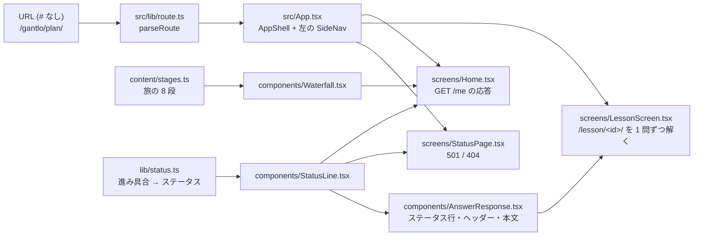
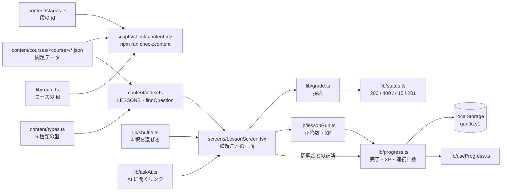

# gantlo

**API と HTTP の基礎を、問題を解きながら学ぶ学習サイト。** 学ぶコースと期間を選ぶとガントチャートで計画し、進捗はブラウザにだけ残します。

サイト: https://maco165.github.io/gantlo/

名前は、ガントチャート (Gantt) と、1969 年に ARPANET で最初に届いた 2 文字「lo」から取りました。管理の歴史と通信の歴史を、1 つの名前で指しています。

## 見せ方

サイト全体を 1 本の HTTP のやり取りに見立てます。画面を見るたびにステータスコードとヘッダーに触れるので、見ること自体が復習になります。

| 場面 | 見せ方 |
|---|---|
| ホーム | `GET /me` への応答。進み具合はステータス (`202` まだ / `206` 途中 / `200` 全部済み) で、記録はレスポンスヘッダーの形で読む |
| リクエストの旅 | 開発者ツールのウォーターフォール。URL を打ってから画面が出るまでの 8 段を、階段の帯で並べる |
| レッスン | 答えを送るボタンは `POST 答えを送る`。結果はレスポンスとして出す: 正解 `200 OK` (`X-XP`・`X-Source`・解説)、不正解 `400 Bad Request` (`X-Expected`・`Retry-After: 86400`・`X-Source`・解説)、メディアタイプの空欄の誤り `415 Unsupported Media Type`、まだ解けない種類 (並べ替え) `501 Not Implemented` |
| レッスン完了 | `201 Created`。`Location: /me/lessons/<id>` と、結果の JSON (`lesson`・`correct`・`total`・`xp`) |
| まだ無い画面 | `501 Not Implemented` |
| 知らない URL | `404 Not Found` |
| メニュー | 左。PC では常に出し、スマホでは左から開く引き出し |

見た目は Meta のデザインシステム [Astryx](https://github.com/meta/astryx) の **Gothic** テーマ (`@astryxdesign/theme-gothic`) です。暗い画面だけのテーマで、飾りの見出し文字は英字にだけ使います。

## 作り



問題データと進捗は、レッスンの画面で次の形でつながります。



| ファイル | 役目 |
|---|---|
| `src/lib/route.ts` | URL の道から画面を決める。# は使わない (検索エンジンが # の後ろを別のページとして扱わないため)。今と同じ道で # だけが違うリンク (本文へ飛ぶリンクなど) は奪わず、画面を移ったことにしない (解いている途中のレッスンが 1 問目に戻らないように) |
| `src/content/stages.ts` | 旅の 8 段の正本 (名前・役目・主な公式文書・何週目か・帯の長さの比) |
| `src/lib/status.ts` | 進み具合と答えの結果を HTTP のステータスにする (答え: 正解 200・不正解 400・メディアタイプの誤り 415・完了 201)。どのステータスにも日本語の説明を付ける |
| `src/content/types.ts` | 問題データの型。問題は 5 種類 (コマンドの穴埋め・HTTP と JSON の穴埋め・並べ替え・4 択・実習) |
| `src/content/courses/<course>/*.json` | 問題データ。置けばそのコースに自動でつながる。様式は [docs/content-format.md](docs/content-format.md) |
| `src/content/index.ts` | 問題データを読み、コースの順に並べる。レッスンと問題を id で引く |
| `scripts/check-content.mjs` | 問題データの検査 (`npm run check:content`)。必須の欄・正解と選択肢や項目の食い違い・id の重なり・旅の段・https の出典を見る。CI でも走る |
| `src/lib/grade.ts` | 採点。前後の空白は無視し、大文字と小文字は区別する。HTTP のヘッダー名とメディアタイプだけは区別しない |
| `src/lib/progress.ts` | 進捗。localStorage の `gantlo.v1` に JSON で置き、サーバーには送らない。壊れた中身は初期値で読み直す |
| `src/lib/useProgress.ts` | 進捗を読み、変えるたびに保存する React のフック |
| `src/screens/LessonScreen.tsx` | レッスンを 1 問ずつ解き、最後に `201 Created` で結果を出す。答えるたびに問題ごとの正誤を、終えたら完了・最高の正答率・XP を進捗に残す。並べ替えは準備中 (`501`) を出して飛ばす |
| `src/components/FillQuestionView.tsx`・`ChoiceQuestionView.tsx`・`LabQuestionView.tsx` | 種類ごとの画面 (コマンドと HTTP・JSON の穴埋め / 4 択 / 実習)。実習は採点せず、全部の手順に印を付けると終えられる |
| `src/components/AnswerResponse.tsx` | 答えの結果を、ステータス行・レスポンスヘッダー・本文 (解説) の形で出す。ヘッダーにも日本語の説明を添える |
| `src/components/AskAi.tsx`・`src/lib/askAi.ts` | 問題文を入れた Claude と ChatGPT を新しいタブで開くリンク。サイトからは何も送らない。答える前は正解・解説を入れない |
| `src/lib/shuffle.ts` | 4 択の選択肢を、開くたび・やり直すたびに混ぜる (`fixedOrder` の問題はそのまま) |
| `src/lib/lessonRun.ts` | 正答数 (採点した問題だけで数える)・XP (正解 1 問 3、実習 10)・結果の JSON |
| `scripts/e2e.mjs` | ブラウザでの通しの検査 (`npm run e2e`)。390 幅と 1280 幅で見本のレッスンを解き、応答・完了・進捗・404・横のはみ出しを見る |
| `src/styles.css` | Astryx の部品で作れない所 (ステータス行・帯・ヘッダーの行) と、狭い画面 (768px 未満) の共通の決まりだけ。狭い画面ではボタン・入力欄の高さのトークン (`--size-element-*`) と 4 択・手順の行を 44px にそろえ、ページごとには大きさを書かない。色はテーマのトークンだけを使う |
| `scripts/spa-fallback.mjs` | `dist/index.html` を `404.html` に写す。画面ごとの HTML を書き出すまでの間、どの道から開いても画面が出るようにする |

## 使い方

```bash
npm ci
npm run dev     # 手元で開く
npm test        # vitest
npm run check:content  # 問題データの検査
npm run build   # dist に書き出す
npm run e2e     # 書き出してから、Playwright の Chromium で通しの操作を確かめる
```

`npm run e2e` は Chromium を使います。手元に無ければ先に `npx playwright install chromium` を打ちます。

`main` にマージすると、GitHub Actions が GitHub Pages に配ります (`.github/workflows/deploy.yml`)。
## まだ無いもの

並べ替えの問題の画面、本物の問題、ホームとコースのレッスンの一覧、計画のガントチャート、復習 (予定の計算と画面)、用語集、画面ごとの HTML の書き出しは、これから作ります。レッスンは今は `/gantlo/lesson/<id>/` を直に開きます。メニューには「準備中」と出しています。

## ライセンス

MIT
