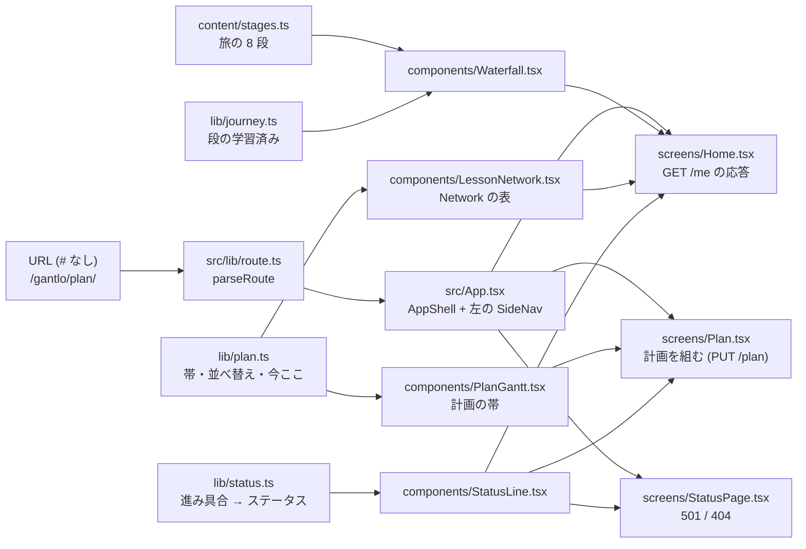
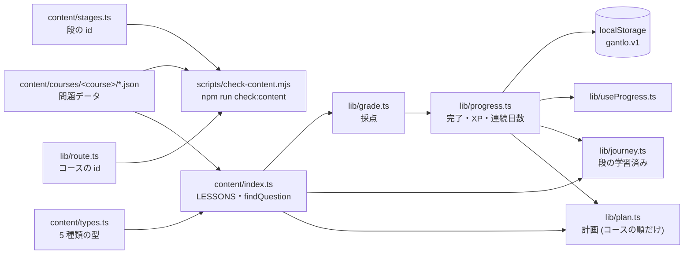

# gantlo

**API と HTTP の基礎を、問題を解きながら学ぶ学習サイト。** 学ぶコースと順を選ぶとガントチャートで計画し、進捗はブラウザにだけ残します。

サイト: https://maco165.github.io/gantlo/

名前は、ガントチャート (Gantt) と、1969 年に ARPANET で最初に届いた 2 文字「lo」から取りました。管理の歴史と通信の歴史を、1 つの名前で指しています。

## 見せ方

サイト全体を 1 本の HTTP のやり取りに見立てます。画面を見るたびにステータスコードとヘッダーに触れるので、見ること自体が復習になります。

| 場面 | 見せ方 |
|---|---|
| ホーム | `GET /me` への応答。進み具合はステータス (`202` まだ / `206` 途中 / `200` 全部済み) で、記録はレスポンスヘッダーの形で読む |
| リクエストの旅 | 開発者ツールのウォーターフォール。URL を打ってから画面が出るまでの 8 段を、階段の帯で並べる。段に紐づくレッスンを 1 つでも終えた段は学習済みで、済んだ割合だけ帯を塗る (全部済めば `200`、途中は `206`) |
| レッスンの一覧 | 開発者ツールの Network タブ。レッスン 1 つが 1 行 (Name・Status・形・Waterfall) で、学ぶ順に並べた Waterfall の列が 1 本のガントチャートになる。済んだ行は `200 完了`、計画の順で最初の未完了の行が「次」 |
| 計画 (`/gantlo/plan/`) | 学ぶコースを選び、上下のボタンで順を並べると、レッスンの数に比例した帯を引く。期限と期間は持たず、横の軸はレッスンの数。`PUT この順で学ぶ` で保存すると `200 OK`。帯に済んだぶんを塗り、「今ここ」を縦の印で示す。計画が無いときは全コースを既定の順 (本編 → 追加のコース) で見せる |
| まだ無い画面 | `501 Not Implemented` |
| 知らない URL | `404 Not Found` |
| メニュー | 左。PC では常に出し、スマホでは左から開く引き出し |

見た目は Meta のデザインシステム [Astryx](https://github.com/meta/astryx) の **Gothic** テーマ (`@astryxdesign/theme-gothic`) です。暗い画面だけのテーマで、飾りの見出し文字は英字にだけ使います。

## 作り



問題データと進捗は、画面とは別に次の形でつながります (解く画面は次の PR で足します)。



| ファイル | 役目 |
|---|---|
| `src/lib/route.ts` | URL の道から画面を決める。# は使わない (検索エンジンが # の後ろを別のページとして扱わないため) |
| `src/content/stages.ts` | 旅の 8 段の正本 (名前・役目・主な公式文書・何週目か・帯の長さの比) |
| `src/lib/status.ts` | 進み具合を HTTP のステータスにする。どのステータスにも日本語の説明を付ける |
| `src/lib/plan.ts` | 計画と学習管理の計算。選んだコースの帯 (レッスンの数に比例し、前の帯の終わりから始まる)・上下の並べ替え・保存・済んだぶんの塗り・今ここ (計画の順で最初の未完了のレッスン)。日付・期間・期限・遅れは持たない |
| `src/lib/journey.ts` | 旅の 8 段の学習済み。段に紐づくレッスン (本編と、段を持つ追加のコース) を 1 つでも終えたら学習済み |
| `src/screens/Home.tsx` | ホーム。ステータス・次のレッスンへのボタン・ウォーターフォール・レスポンスヘッダー (今日の XP / 目標・連続日数・復習の数・追加のコース)・Network の表 |
| `src/screens/Plan.tsx` | 計画を組む画面。並べ替えたあとは押したボタンに手元を戻し、キーボードだけで続けて動かせる。ボタンは 44px 以上 |
| `src/components/LessonNetwork.tsx` | Network の表 (レッスン 1 つが 1 行)。390 幅では形の列を隠す |
| `src/components/PlanGantt.tsx` | 計画のガントチャート。帯・済みの塗り・今ここの縦の印・次のレッスンへのリンク |
| `src/content/types.ts` | 問題データの型。問題は 5 種類 (コマンドの穴埋め・HTTP と JSON の穴埋め・並べ替え・4 択・実習) |
| `src/content/courses/<course>/*.json` | 問題データ。置けばそのコースに自動でつながる。様式は [docs/content-format.md](docs/content-format.md) |
| `src/content/index.ts` | 問題データを読み、コースの順に並べる。レッスンと問題を id で引く |
| `scripts/check-content.mjs` | 問題データの検査 (`npm run check:content`)。必須の欄・正解と選択肢や項目の食い違い・id の重なり・旅の段・https の出典を見る。CI でも走る |
| `src/lib/grade.ts` | 採点。前後の空白は無視し、大文字と小文字は区別する。HTTP のヘッダー名とメディアタイプだけは区別しない |
| `src/lib/progress.ts` | 進捗。localStorage の `gantlo.v1` に JSON で置き、サーバーには送らない。壊れた中身は初期値で読み直す |
| `src/lib/useProgress.ts` | 進捗を読み、変えるたびに保存する React のフック |
| `src/styles.css` | Astryx の部品で作れない所 (ステータス行・帯・ヘッダーの行) だけ。色はテーマのトークンだけを使う |
| `scripts/spa-fallback.mjs` | `dist/index.html` を `404.html` に写す。画面ごとの HTML を書き出すまでの間、どの道から開いても画面が出るようにする |

## 使い方

```bash
npm ci
npm run dev     # 手元で開く
npm test        # vitest
npm run check:content  # 問題データの検査
npm run build   # dist に書き出す
```

`main` にマージすると、GitHub Actions が GitHub Pages に配ります (`.github/workflows/deploy.yml`)。
## まだ無いもの

問題を解く画面、本物の問題、復習 (`Retry-After` の数はまだ 0)、進捗・用語集・設定の画面、画面ごとの HTML の書き出しは、これから作ります。メニューには「準備中」と出しています。

## ライセンス

MIT
