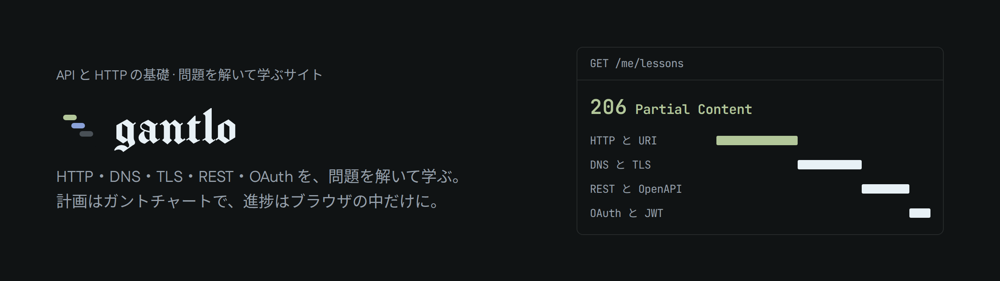
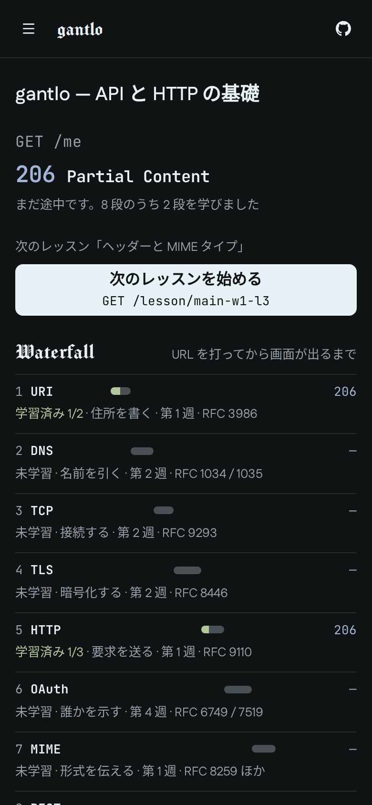

<picture>
  <source media="(prefers-color-scheme: dark)" srcset="docs/images/banner.png">
  
</picture>

**gantlo** は、API と HTTP の基礎を、問題を解きながら学ぶ無料のサイトです。

**サイト: https://maco165.github.io/gantlo/**

登録は要りません。学習の記録は、お使いのブラウザの中だけに残ります。

## できること

- **レッスン**: HTTP・DNS・TLS・REST・OAuth などを、穴埋め・4 択・並べ替えで学ぶ
- **計画**: 学ぶコースを選ぶと、ガントチャートで予定を引く
- **復習**: 間違えた問題が翌日・3 日後・7 日後にまた出る
- **模擬試験**: 40 問・60 分の総まとめ
- **ハンドブックと用語集**: 仕組みを curl の実例で読み、語を出典つきで引く
- **試す**: 公開の API に本物の要求を送って、返事を見る

<table>
  <tr>
    <td width="33%"></td>
    <td width="33%"></td>
    <td width="33%"></td>
  </tr>
  <tr>
    <td>ホーム</td>
    <td>計画</td>
    <td>コマンドの穴埋め</td>
  </tr>
</table>


名前は、ガントチャート (Gantt) と、1969 年に ARPANET で最初に届いた 2 文字「lo」から取りました。

## 開発

React と [Astryx](https://github.com/meta/astryx) で作り、GitHub Pages で配っています。

```bash
npm ci
npm run dev    # 手元で開く
npm test       # テスト
npm run build  # 組み立て
```

くわしい作りは [docs/design.md](docs/design.md) にあります。誤りを見つけたら [Issue](https://github.com/maco165/gantlo/issues) で教えてください。

## ライセンス

MIT
