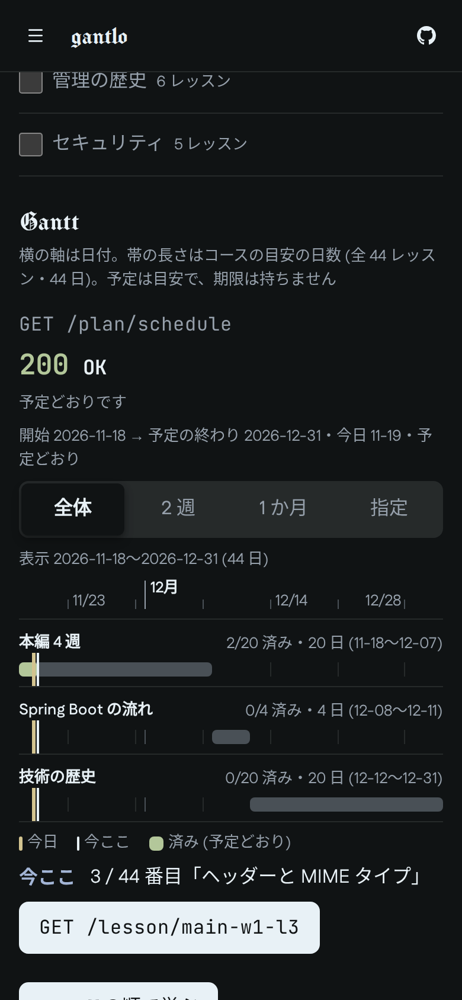
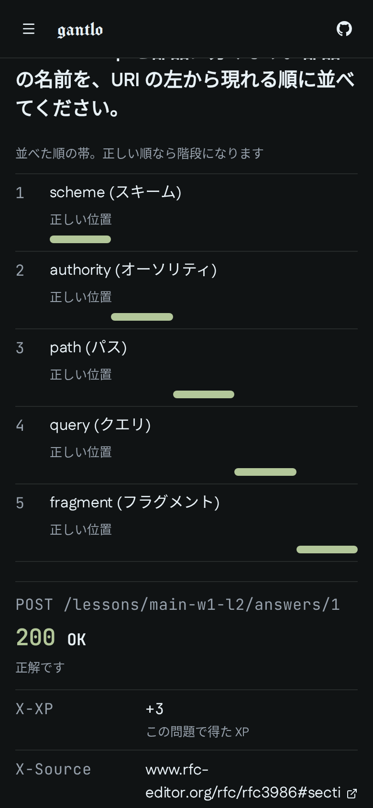
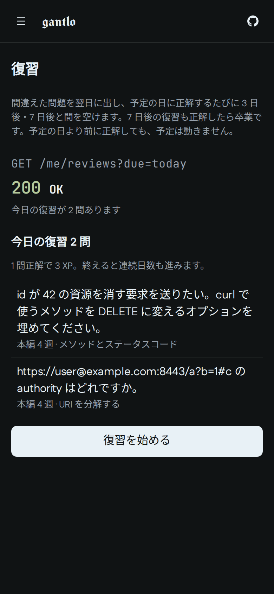
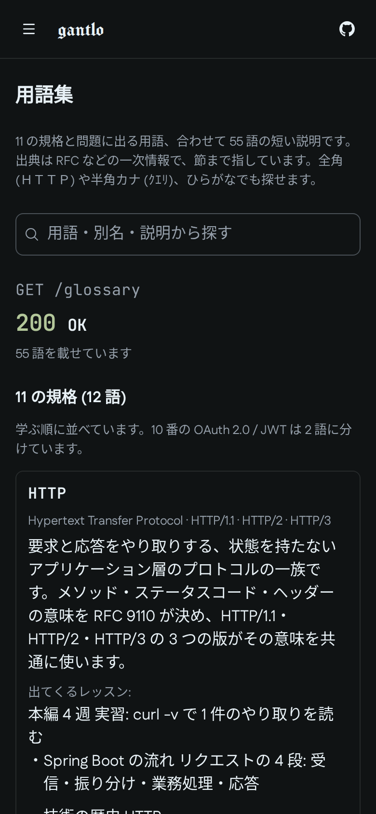
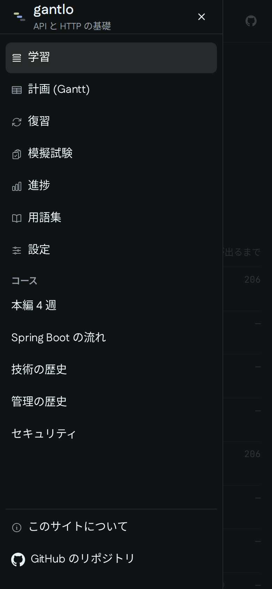
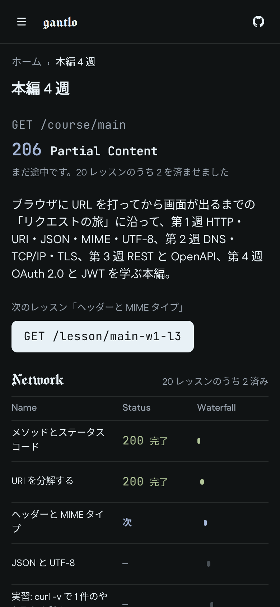
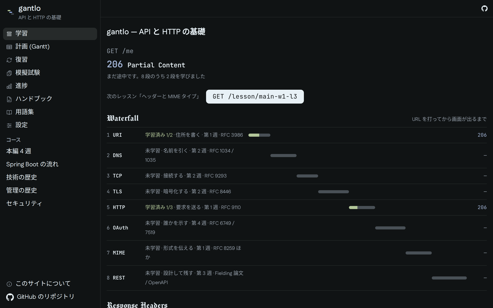
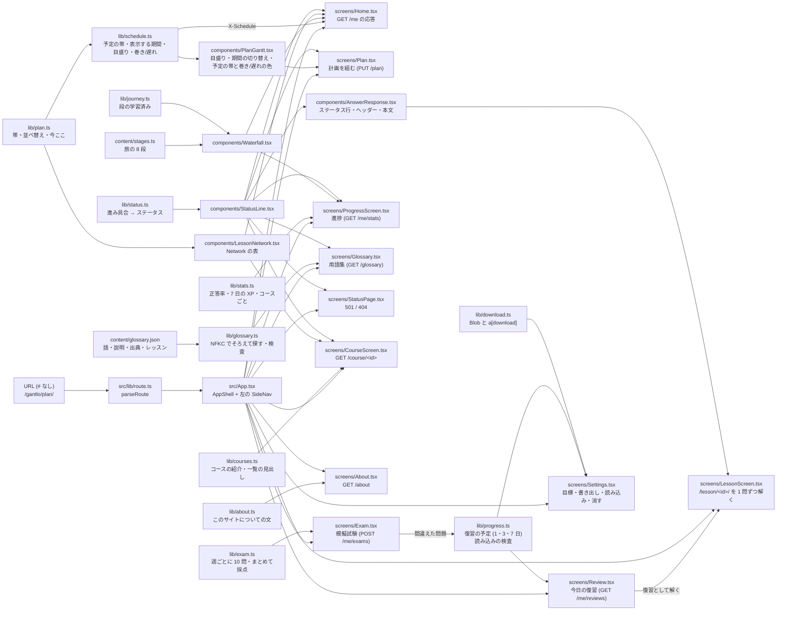
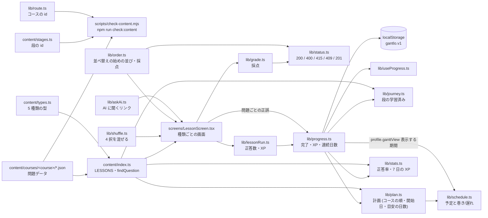
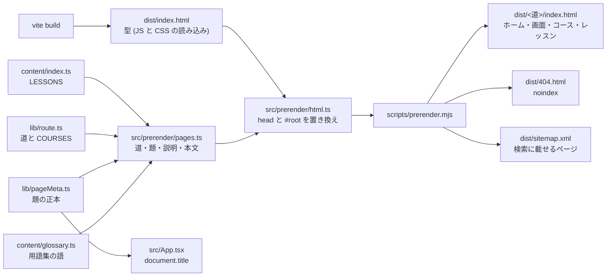

<picture>
  <source media="(prefers-color-scheme: dark)" srcset="docs/images/banner.png">
  
</picture>

**gantlo** は、API と HTTP の基礎 (HTTP・URI・JSON・DNS・TLS・REST・OAuth) を、curl や HTTP の穴埋め・4 択・並べ替えの問題で学ぶ学習サイト。学ぶコースと順を選ぶとガントチャートで計画を引き、画面を見るたびに HTTP のステータスコードとヘッダーに触れる。間違えた問題は日をおいて復習に出し、本編 4 週の総まとめに模擬試験 (40 問・60 分・合格 75%) を置き、問題に出る語は一次情報の出典つきの用語集にまとめる。進捗はブラウザの localStorage にだけ残し、サーバーは持たない。名前は、ガントチャート (Gantt) と、1969 年に ARPANET で最初に届いた 2 文字「lo」から取った。

| | |
|---|---|
| サイト | https://maco165.github.io/gantlo/ (サイト名と副題の正本は `src/lib/site.ts`) |
| 見た目 | Meta の [Astryx](https://github.com/meta/astryx) の **Gothic** テーマ (`@astryxdesign/theme-gothic`)。暗い画面だけ |
| 管理 | [AI-Repository](https://github.com/maco165/AI-Repository) の PJ-029 (要件と backlog は `projects/PJ-029-api-basics/design/`) |

この README は設計書を兼ねる。作りを変えたら、同じ PR でここと図と画像を直す (画像は `npm run readme:images`)。帯の画像は Gothic が暗い画面だけなので 1 枚 (`docs/images/banner.png`) にし、明るい表示の GitHub でも同じ画像を出す。

## 画面

<table>
  <tr>
    <td width="33%"></td>
    <td width="33%"></td>
    <td width="33%"></td>
  </tr>
  <tr>
    <td>ホーム。進み具合をステータスで返し、旅の 8 段を開発者ツールのウォーターフォールの形で見せる</td>
    <td>計画。学ぶコースと順・開始日・目安の日数を決めると予定の帯を引き、巻き・遅れを出す</td>
    <td>穴埋めの不正解は <code>400 Bad Request</code>。正しい答え・翌日の復習・出典をヘッダーの形で出す</td>
  </tr>
</table>

<table>
  <tr>
    <td width="25%"></td>
    <td width="25%"></td>
    <td width="25%"></td>
    <td width="25%"></td>
  </tr>
  <tr>
    <td>並べ替え。上下のボタンで動かし、正しい順なら帯が階段になる</td>
    <td>復習。間違えた問題を翌日・3 日後・7 日後に出す</td>
    <td>進捗。正答率・7 日の XP・コースごとの済んだレッスン</td>
    <td>用語集。11 の規格と問題に出る語を、RFC などの出典つきで</td>
  </tr>
</table>

<table>
  <tr>
    <td width="33%"></td>
    <td width="33%"></td>
    <td width="33%"></td>
  </tr>
  <tr>
    <td>メニュー。左から開き、「このサイトについて」と「GitHub のリポジトリ」は下端に留める</td>
    <td>このサイトについて。ソースコード・誤りの知らせ方・記録の置き場所・ライセンス</td>
    <td>コース。そのコースのレッスンを順に並べ、済みの印と次のレッスンへのボタンを出す</td>
  </tr>
</table>



## 見せ方

サイト全体を 1 本の HTTP のやり取りに見立てます。画面を見るたびにステータスコードとヘッダーに触れるので、見ること自体が復習になります。

| 場面 | 見せ方 |
|---|---|
| ホーム | `GET /me` への応答。進み具合はステータス (`202` まだ / `206` 途中 / `200` 全部済み) で、記録はレスポンスヘッダーの形で読む。計画の予定と比べた巻き・遅れは `X-Schedule` (例: `408 2 日遅れ`)。計画を一度も保存していないうちは `204 計画なし` |
| リクエストの旅 | 開発者ツールのウォーターフォール。URL を打ってから画面が出るまでの 8 段を、階段の帯で並べる。段に紐づくレッスンを 1 つでも終えた段は学習済みで、済んだ割合だけ帯を塗る (全部済めば `200`、途中は `206`) |
| レッスン | 答えを送るボタンは `POST 答えを送る`。結果はレスポンスとして出す: 正解 `200 OK` (`X-XP`・`X-Source`・解説)、不正解 `400 Bad Request` (`X-Expected`・`Retry-After: 86400`・`X-Source`・解説)、メディアタイプの空欄の誤り `415 Unsupported Media Type`、並べ替えの順の誤り `409 Conflict` (「N 行が違う位置です」) |
| 並べ替え | 上下のボタンで行を動かす (ドラッグに頼らない)。確かめると、並べた順の行ごとに、その項目の正しい位置へ帯を描く。正しい順なら帯が階段になり、違う位置の行は誤りの色になる |
| レッスン完了 | `201 Created`。`Location: /me/lessons/<id>` と、結果の JSON (`lesson`・`correct`・`total`・`xp`) |
| レッスンの一覧 | 開発者ツールの Network タブ。レッスン 1 つが 1 行 (Name・Status・形・Waterfall) で、学ぶ順に並べた Waterfall の列が 1 本のガントチャートになる。済んだ行は `200 完了`、計画の順で最初の未完了の行が「次」 |
| コース (`/gantlo/course/<id>/`) | `GET /course/<id>` への応答。ステータスはホームと同じ決まりで、数えるのはそのコースのレッスン (`202` まだ / `206` 途中 / `200` 全部済み。レッスンがまだ無いコースは本文の無い `204 No Content`)。コースの紹介・次のレッスンへのボタン (`GET /lesson/<id>`)・そのコースのレッスンだけの Network の表 (済んだ行は `200 完了`、最初の未完了の行が「次」)。見出し・紹介・一覧の順は書き出す HTML と同じ |
| 計画 (`/gantlo/plan/`) | 学ぶコースを選び、上下のボタンで順を並べ、開始日とコースごとの目安の日数 (既定は 1 レッスン 1 日) を決めると、WBS のように開始日から学ぶ順に予定の帯を引く。横の軸は日付で、帯の上に週の頭 (月曜) と月の境 (1 日) の目盛りを出し (狭い幅では字が重ならないよう間引く)、今日に縦の線を引く。表示する期間は `全体`・`2 週`・`1 か月`・`指定` (始まりと終わりの日。2 年 = 731 日まで) から選べ、期間の外にはみ出す帯は端で切る。選んだ期間は設定 (`profile.ganttView`) にすぐ残る。済んだ量を今日の予定と比べ、`GET /plan/schedule` の応答で巻き (`200 OK`「N 日巻き」、情報の色の青)・予定どおり (`200 OK`、成功の色の緑)・遅れ (`408 Request Timeout`「N 日遅れ」、誤りの色) を出し、済みの塗りも同じ色にする。色だけに頼らず、凡例とステータスに字でも書く。目安の日数に範囲外の値を打つと「1〜365 の整数」と知らせ、既定と同じ値は直した値として残さない。予定は目安で、期限・取り戻し方・通知は持たない。`PUT この順で学ぶ` で保存すると `200 OK`。帯に済んだぶんを塗り、「今ここ」を縦の印で示す。計画が無いときは全コースを既定の順 (本編 → 追加のコース) で見せる |
| 復習 (`/gantlo/review/`) | `GET /me/reviews?due=today` への応答。今日の復習があれば `200 OK` と問題の一覧、無ければ `204 No Content` と次の予定。解き終えると `200 OK` (レッスンの記録は作らないので `201` にしない) |
| 模擬試験 (`/gantlo/exam/`) | `GET /exam` への応答 (`200 OK`)。本編 4 週の採点する問題 (実習を除く) から各週 10 問ずつ 40 問を開くたびに選び直し、60 分で解く。解いている間は正誤 (応答の枠) と AI に聞くリンクを出さず、`POST 答えを送って次へ` で次の問題へ進む。上の帯に残り時間 (残り 5 分を切ると誤りの色)。終えると `POST /me/exams` の `201 Created`、60 分を過ぎると答えていない問題を不正解として `408 Request Timeout` (`X-Unanswered` に数)。合否は `X-Result` (75% ちょうどは合格) と見出しに出し、週ごとの正答率・いちばん低い週と、その週で間違えた問題のあるレッスンへのリンク・問題ごとの正誤 (誤りには正しい答えと解説) を出す。間違えた・答えなかった問題は翌日の復習に入り、正解 1 問 3 XP。回の記録 (`exams`、新しい順に 20 回まで) を、これまでの回として出す。途中でやめると記録しない |
| 設定 (`/gantlo/settings/`) | 目標を変えると `PATCH /me/profile` の `200`、書き出しは `GET`、読み込みは `PUT /me` の `200`。1 MB を超えるファイルは `413 Content Too Large`、壊れたファイルは `422 Unprocessable Content` で読まず、理由を出す。記録を消すと `DELETE /me` の `204` |
| 進捗 (`/gantlo/progress/`) | `GET /me/stats` への応答。ステータスはホームと同じ旅の段の進み具合 (`202` / `206` / `200`)。正答率 (レッスンと復習で答えた回数のうち正解の割合)・この 7 日の XP (日ごとの棒)・連続日数、コースごとの済んだレッスンの数と正答率、旅の 8 段の学習状況 (ウォーターフォール) を出す |
| 用語集 (`/gantlo/glossary/`) | `GET /glossary?q=<探す語>` への応答。当たれば `200 OK` と語の数、無ければ `204 No Content`。探す語は URL の形 (パーセントエンコーディング) で見せる。11 の規格を学ぶ順に、問題に出る用語を読みの順に並べ、どの語にも短い説明・一次情報の出典 (RFC は節まで)・出てくるレッスンへのリンクを付ける。探しているときは当たりのよい順の 1 つの一覧 |
| このサイトについて (`/gantlo/about/`) | `GET /about` への応答 (`200 OK`)。サイトの説明・ソースコード (GitHub)・Issue を書く・記録の置き場所・AI に聞く・問題の出典・ライセンス。文の正本は `src/lib/about.ts` |
| まだ無い画面 | `501 Not Implemented` |
| 知らない URL | `404 Not Found` |
| メニュー | 左。PC では常に出し、スマホでは左から開く引き出し。「このサイトについて」と「GitHub のリポジトリ」は一覧の下端に留める (PC は SideNav の `footer`、スマホは MobileNav に footer が無いので CSS の sticky。一覧のリンクは下端の 2 つの高さ (`--nav-foot-h`) を `scroll-margin-bottom` にし、Tab で進んでも隠れない) |
| 上の帯 | 右端に GitHub のリポジトリを新しいタブで開くボタン (どの画面でも)。スマホでは左端にメニューのボタンとサイト名も置く |

見た目は Meta のデザインシステム [Astryx](https://github.com/meta/astryx) の **Gothic** テーマ (`@astryxdesign/theme-gothic`) です。暗い画面だけのテーマで、飾りの見出し文字は英字にだけ使います。

## 作り



問題データと進捗は、レッスンの画面で次の形でつながります。



検索に届く形 (# の無い URL・ページごとの HTML・sitemap) は、`npm run build` のあとに次の形で書き出します。GitHub Pages は `dist/<道>/index.html` があれば HTTP 200 で返すので、下層の URL (`/gantlo/plan/` など) も 200 になります。知らない道は `404.html` (HTTP 404) で、画面は JS で 404 を出します。



| ファイル | 役目 |
|---|---|
| `src/lib/route.ts` | URL の道から画面を決める。# は使わない (検索エンジンが # の後ろを別のページとして扱わないため)。今と同じ道で # だけが違うリンク (本文へ飛ぶリンクなど) は奪わず、画面を移ったことにしない (解いている途中のレッスンが 1 問目に戻らないように)。`useRoute` は画面をやり直す合図 `nav` と、スマホのメニューを閉じる合図 `close` を分けて返す (# だけが変わる戻る・進むでは `close` だけが増える) |
| `src/content/stages.ts` | 旅の 8 段の正本 (名前・役目・主な公式文書・何週目か・帯の長さの比) |
| `src/lib/status.ts` | 進み具合と答えの結果を HTTP のステータスにする (答え: 正解 200・不正解 400・メディアタイプの誤り 415・並べ替えの順の誤り 409・完了 201。コース: まだ 202・途中 206・全部済み 200・レッスンが無ければ 204)。どのステータスにも日本語の説明を付ける |
| `src/lib/plan.ts` | 計画と学習管理の計算。上下の並べ替え・保存 (順・開始日・直した目安の日数)・今ここ (計画の順で最初の未完了のレッスン)。期限は持たない |
| `src/lib/schedule.ts` | おおよその予定と巻き・遅れ (R-20)、表示する期間と日付の目盛り (R-21)。目安の日数の既定は 1 レッスン 1 日 (1 レッスン約 15 XP は 1 日の目標の既定 30 XP の半分で、残りを復習に回せる量)。本人が直した値は `plan.days` に残し、既定と同じ値を打つと外す (`setCourseDays`)。直していないコースはレッスン数から数え直す (問題が増えれば伸びる)。レッスンの無いコースは 0 日。開始日は保存したもの、無ければ (古い記録も) 最初にレッスンを終えた日、それも無ければ今日。済んだ量は「コースの日数 ÷ レッスンの数」を済んだレッスンごとに足した日数で、昨日までの予定より少なければ遅れ、今日の終わりまでの予定より多ければ巻き、その間は予定どおり。日数は差を 1 日単位に切り上げる。判定の色は予定どおりが成功 (緑)・巻きが情報 (青)・遅れが誤り (`verdictTone`)。表示する期間 (`viewRange`) は全体 (開始日から予定の終わりまで。今日が外れていれば今日まで広げる)・今日から 2 週 (14 日)・今日から 1 か月 (1 か月後の前の日まで。月に無い日は月末に収める)・指定 (両端を含む。2 年 = 731 日まで。超える値は読み込みでも落として全体に戻す。`rangeProblem` は空・逆順・長すぎるを分ける) で、期間の外の帯は端で切り、今日と今ここが外なら出さない。目盛り (`axisTicks`) は週の頭 (月曜) と月の境 (1 日)、字は月の境を先に残して間を空けて間引く (`labelTicks`)。目盛りが 200 本を超える長い軸では月の境だけにする。ホームの `X-Schedule` (`scheduleHeader`) は計画を保存する前は `204 計画なし`。日の差は暦の日付どうしを UTC の 0 時に置いて数えるので、時差・夏時間でずれない |
| `src/lib/journey.ts` | 旅の 8 段の学習済み。段に紐づくレッスン (本編と、段を持つ追加のコース) を 1 つでも終えたら学習済み |
| `src/screens/Home.tsx` | ホーム。ステータス・次のレッスンへのボタン・ウォーターフォール・レスポンスヘッダー (今日の XP / 目標・連続日数・復習の数・追加のコース)・Network の表 |
| `src/screens/Plan.tsx` | 計画を組む画面。開始日 (日付の入力欄) と、選んだコースごとの目安の日数 (1〜365 日) を直すと、保存の前でも帯と巻き・遅れがその場で変わる。並べ替えたあとは押したボタンに手元を戻し、キーボードだけで続けて動かせる。チェックを切り替えても手元はそのチェックに残る。ボタンの高さは Astryx のボタンと同じトークンで、狭い画面では 44px |
| `src/screens/CourseScreen.tsx` | コースの画面。そのコースのレッスンを Network の表に並べ、次のレッスンへのボタンを出す。`key` にコースの id を付け、コースを移ると描き直す |
| `src/lib/courses.ts` | コースの紹介文・一覧の見出し (`Network`)・レッスンの無いコースの文の正本。コースの画面と書き出す HTML (`src/prerender/pages.ts`) が同じものを使い、見出しが食い違わないようにする |
| `src/components/LessonNetwork.tsx` | Network の表 (レッスン 1 つが 1 行)。ホームとコースの画面で使う。390 幅では形の列を隠し、レッスンのリンクの押せる高さを 44px にする |
| `src/components/PlanGantt.tsx` | 計画のガントチャート。表示する期間の切り替え (Astryx の `SegmentedControl`。指定は日付の入力欄 2 つで、空・終わりが始まりより前・2 年を超えるときは軸を変えず、`aria-invalid` とそれぞれの補助の文)、日付の目盛り (狭い画面は軸の 18%、広い画面は 12% の間を空けて字を間引き、右端の字は左へ寄せる)、予定の帯 (端で切れた側は角を丸めない)・判定の色の済みの塗り・今日の線・今ここの縦の印・巻き/遅れのステータスと凡例 (字でも書く)・次のレッスンへのリンク。選んだ期間は設定 (`profile.ganttView`) にすぐ残す |
| `src/content/types.ts` | 問題データの型。問題は 5 種類 (コマンドの穴埋め・HTTP と JSON の穴埋め・並べ替え・4 択・実習) |
| `src/content/courses/<course>/*.json` | 問題データ。置けばそのコースに自動でつながる。様式は [docs/content-format.md](docs/content-format.md) |
| `src/content/index.ts` | 問題データを読み、コースの順に並べる。レッスンと問題を id で引く |
| `scripts/check-content.mjs` | 問題データの検査 (`npm run check:content`)。必須の欄・正解と選択肢や項目の食い違い・id の重なり・旅の段・https の出典を見る。CI でも走る |
| `src/lib/grade.ts` | 採点。前後の空白は無視し、大文字と小文字は区別する。HTTP のヘッダー名とメディアタイプだけは区別しない |
| `src/lib/progress.ts` | 進捗。localStorage の `gantlo.v1` に JSON で置き、サーバーには送らない。壊れた中身は初期値で読み直す。復習の予定 (`recordAnswer`): 間違えると翌日、予定日以降の正解で 3 日後・7 日後、7 日後も正解で卒業、予定日より前の正解は据え置き。日付は端末の時刻の日付 (`dayKey`) で数え、時差で 1 日ずれない。読み込み (`parseImport`) は 1 MB まで、`v` が 1 で `streak`・`xp`・`lessons`・`answers` がオブジェクトのものだけを読み、読めない理由を返す。目標と計画は、読み込んだ側に無いときだけ今の端末から引き継ぐ。計画の開始日と目安の日数も、読み直し・書き出し・読み込み・記録を消すときに写して残す (壊れた値は読むときに落として既定で補う)。模擬試験の回の記録 (`exams`: 終えた時刻・正答数・問題の数・時間切れか) は、形の合う回だけを 20 回まで読む (正答数が問題の数を超える回は落とす)。記録を消すと回の記録も消える |
| `src/lib/useProgress.ts` | 進捗を読み、変えるたびに保存する React のフック |
| `src/screens/LessonScreen.tsx` | レッスンを 1 問ずつ解き、最後に `201 Created` で結果を出す。答えるたびに問題ごとの正誤を、終えたら完了・最高の正答率・XP を進捗に残す。4 択の選択肢と並べ替えの項目は、開くたび・やり直すたびに混ぜる |
| `src/components/FillQuestionView.tsx`・`ChoiceQuestionView.tsx`・`OrderQuestionView.tsx`・`LabQuestionView.tsx` | 種類ごとの画面 (コマンドと HTTP・JSON の穴埋め / 4 択 / 並べ替え / 実習)。並べ替えは上下のボタンで動かし、動かしたあとも手元 (focus) を動かした行のボタンに残す (端で押せなくなったら押せる方へ)。実習は採点せず、全部の手順に印を付けると終えられる |
| `src/lib/order.ts` | 並べ替えの計算。始めの並び (正しい順の間は混ぜ直し、項目が 2 つ以上なら正解と同じ並びで始めない。正しい順を除く並びは同じ割合で出る)・上下に動かす・採点 (ずれた行の数と行ごとの正誤) |
| `src/components/AnswerResponse.tsx` | 答えの結果を、ステータス行・レスポンスヘッダー・本文 (解説) の形で出す。ヘッダーにも日本語の説明を添える |
| `src/components/AskAi.tsx`・`src/lib/askAi.ts` | 問題文を入れた Claude と ChatGPT を新しいタブで開くリンク。サイトからは何も送らない。答える前は正解・解説・並べ替えの正しい順を入れない |
| `src/lib/shuffle.ts` | 4 択の選択肢を、開くたび・やり直すたびに混ぜる (`fixedOrder` の問題はそのまま) |
| `src/lib/lessonRun.ts` | 正答数 (実習を除く採点した問題で数える。並べ替えも入る)・XP (正解 1 問 3、実習 10)・結果の JSON・完了画面の一覧のコード (答えの画面に出したコードと同じ。並べ替えの誤りは 409、メディアタイプの誤りは 415) |
| `scripts/e2e.mjs` | ブラウザでの通しの検査 (`npm run e2e`)。390 幅と 1280 幅で、問題データから選んだレッスン (並べ替え・4 択・穴埋めを持つものと、メディアタイプの空欄・実習を持つもの) を解き、応答・完了・進捗・404・横のはみ出し・答える前の AI のリンク (全種類)・本文へ飛ぶリンク・390 幅の押せる範囲 (44px)・並べ替えをキーボード (Tab と Enter) だけで正解にできること・409 で違う位置の行が誤りの色になることを見る |
| `src/lib/exam.ts` | 模擬試験の計算。出題の元 (`examBank`) は本編のレッスン (id の `main-w<週>-` から週を読む) の実習を除く問題。`pickExam` は週ごとに 10 問を重ならずに選び、全体の並びと 4 択の選択肢・並べ替えの項目を混ぜる。`gradeExam` は答えていない問題を不正解に数え、正答率・合否 (`PASS_MARK` 0.75 以上)・週ごとの正答率・いちばん低い週 (同じなら先の週、全部満点なら無し) を返す。`recordExam` は全部の問題を `recordAnswer` に通し (間違えた・答えなかった問題は翌日の復習)、正解 1 問 3 XP を足し、回の記録を先頭に足す (`MAX_EXAM_RECORDS` 20 回まで。読み込みでも同じ数で切る) |
| `src/screens/Exam.tsx` | 模擬試験の画面。始める前・解いている途中・結果の 3 つ。問題は種類ごとの画面 (`isExam`) で出し、答えを送ると正誤を見せずに次へ進む。残り時間は 1 秒ごとに数え直し、0 になったら 1 回だけ採点する (最後の答えと時計が重なっても 2 回記録しない)。並べ替えの送るボタンは並べ方によらず押せるので、出してから 0.4 秒の間の答えは捨てる (2 度押しの 2 回目で次の問題を送らない)。途中の回は記録に残さないので、画面を離れると消える |
| `scripts/e2e-exam.mjs` | `scripts/e2e.mjs` から呼ぶ、模擬試験の通しの検査 (B-027)。390 幅と 1280 幅で、40 問が各週 10 問ずつで実習と重なりが無いこと、解いている間は正誤の枠と AI のリンクが出ないこと、30 問正解で `201`・合格・週ごとの正答率・読み直すレッスン (リンクで開く)・記録と復習と XP、不正解の行に正しい答えと解説が出ること、並べ替えを出した直後の送るを受け付けないこと (2 度押しの止め)、途中でやめると記録しないこと、時計を 60 分進めると `408` と `X-Unanswered`、390 幅で 44px 以上であることを見る |
| `src/screens/Review.tsx` | 復習の画面。始めたときの今日の問題を、レッスンの画面 (`LessonScreen` の `review`) で 1 問ずつ解く。復習ではレッスンの完了を付けず、XP と連続日数だけを進め、閉じると復習の画面へ戻る。答えは `POST /me/reviews/answers/N`、終えたときの本文は `reviewed`・`correct`・`xp` で、完了のステータス行 `POST /me/reviews` とそろえる (`lessonRun.ts` の `answerRequest`・`reviewResultBody`) |
| `src/screens/Settings.tsx`・`src/lib/download.ts` | 設定の画面。1 日の目標 (10・20・30・50 XP)、記録の書き出し (画面の中で Blob を作って a[download] を押す)、読み込み (file input。確かめてから置き換える)、記録を消す (画面の中の確認の dialog を挟む。`confirm()` は使わない。目標と計画は残す)。1 MB を超えるファイルは中身を読まずに断ることを `tests/settings.test.ts` (jsdom) で確かめる |
| `scripts/e2e-lessons.mjs` | e2e の検査が共に使う、問題データの読み方・解くレッスンの選び方・種類ごとの答え方・期待の正答数と XP の数え方。検査は本物の問題データの中身 (何問目が何の種類か・XP の合計) を決め打ちせず、ここでデータから探して数える。単体のテストは `tests/fixtures/sample-lesson.ts` の見本のレッスンを使う |
| `scripts/e2e-review-settings.mjs` | `scripts/e2e.mjs` から呼ぶ、復習と設定の画面の通しの検査。時計を止め、UTC と手元の日付が違う時差 (390 幅は東京、1280 幅はロサンゼルス) で、今日の復習を解くと 0 問になること・目標 10 XP がホームに出ること・書き出した JSON を読み込むと記録が戻ること・壊れたファイル (422) と 1 MB を超えるファイル (413) を読まないこと・記録を消す前に確かめること・390 幅でボタンが 44px 以上であることを見る |
| `scripts/e2e-home-plan.mjs` | `scripts/e2e.mjs` から呼ぶ、ホームと計画の画面の通しの検査。空の状態から次のレッスンを終えて戻ると完了・段の学習済み・XP の増加が出ること (390・1280 幅)、390 幅でキーボードだけで並べ替えて保存できボタンが 44px 以上であること、1280 幅で計画の帯・済みの塗り・今ここ・次のレッスンへのリンクが出てレッスンが開くことを見る |
| `scripts/e2e-schedule.mjs` | `scripts/e2e.mjs` から呼ぶ、予定・巻き/遅れ・目盛り・表示する期間の検査。Playwright の clock で今日を決め、問題データから選んだコースの計画を置いて、390・1280 幅で次を見る。計画を保存する前のホームが `204 計画なし`。予定の帯・今日の線 (3 日目の中ほど)・遅れの `408`。目安の日数を変えるとその場で帯と判定 (予定どおり・2 日巻き) が変わり、範囲外の値 (0・400・2.5・-3) は `aria-invalid` と「1〜365 の整数」で知らせる。遅れ・予定どおり・巻きの塗りとコードの色が誤り・成功・情報の token の色で、凡例に字がある。目盛りの字が重ならず軸からはみ出さない。2 週・1 か月・指定で軸・目盛り・帯 (端で切れる) が変わり、選んだ期間が残って読み直しても同じ。保存すると開始日と日数が残り、既定と同じ日数は残らない。開始日を変えると帯が動く。ホームの `X-Schedule`。390 幅の入力欄・切り替え・ボタンが 44px 以上、コントラスト 4.5:1 以上。`E2E_SHOT_DIR` を付けると画面の写しを置く |
| `scripts/e2e-course.mjs` | `scripts/e2e.mjs` から呼ぶ、コースの画面の検査 (B-024)。390 幅と 1280 幅で、5 コースの `/gantlo/course/<id>/` が HTTP の 200 で見出しが題と同じ、レッスンがデータの順に並び空の記録で `202`、1 つ済ませると「200 完了」・「次」・`206`・次のレッスンのボタンが出てレッスンが開くこと、表の行のリンクでも開くこと、全部済めば `200`、メニューのコースに「準備中」が無く開いたコースが選ばれた印になること、390 幅でボタンと表のリンクが 44px 以上であることを見る。`E2E_SHOT_DIR` を付けると途中のコースの画面の写しを置く |
| `scripts/e2e-narrow.mjs` | `scripts/e2e.mjs` から呼ぶ、390 幅の崩れの検査 (B-025)。390 幅と 1280 幅で、問題データでいちばん長い出典を持つ問題に答え、出典 (`X-Source`) の外部リンクの箱と印の右端が応答の枠の内にあること、用語集の「出てくるレッスン」と出典の区切り (・) の縦の中心が前か後ろのリンクの箱の内にある (1 行を占めない) ことを見る |
| `scripts/e2e-contrast.mjs` | `scripts/e2e.mjs` から呼ぶ、テーマと文字のコントラストの検査。390 幅と 1280 幅で、ホーム・計画・復習 (予定なしと今日の分あり)・レッスンの問題と応答 (400 / 200 / 409)・完了 (201)・404・進捗・コース・用語集 (全角で探したあとも)・設定と記録を消す確かめの dialog・このサイトについてを開き、テーマが Gothic (地の token が `#101314`) であることと、文字を持つ見える要素 (本文・補助の文字・ボタン・リンク・ステータスのコード・入力欄) の文字の色と実際の地の色 (根から要素まで地を塗り重ね、opacity の祖先は字と地の両方を奥の地に重ねる) のコントラスト比が WCAG の相対輝度で 4.5:1 以上であることを見る。空の入力欄は placeholder を、390 幅ではスマホのメニューを開いた状態も測る。大きな文字の 3:1 の例外は使わず、押せないボタンは数えない。測り方は合成のページ (opacity 0.5 の群で約 3.98:1) で確かめる |
| `src/styles.css` | Astryx の部品で作れない所 (ステータス行・帯・ヘッダーの行) と、狭い画面 (768px 未満) の共通の決まりだけ。狭い画面ではボタン・入力欄の高さのトークン (`--size-element-*`) と 4 択・手順の行・入力欄の消すボタン・文の中に並ぶリンク (箱に `tap-links` を付ける) を 44px にそろえ、ページごとには大きさを書かない。色はテーマのトークンだけを使う。括弧の崩れはブラウザも build も黙って読むので、`tests/styles.test.ts` が postcss で読んで見つける |
| `src/screens/ProgressScreen.tsx`・`src/lib/stats.ts` | 進捗の画面と、その計算。正答率は問題ごとの記録 (`answers`) の正解と不正解の回数を、問題データにある問題だけ足して出す (採点しない実習は入らない)。7 日の XP は今日を含む 7 日を端末の時刻の日付で数える。コースごとに済んだレッスンの数・レッスンの数・正答率を出し、レッスンの無いコースは「準備中」 |
| `src/content/glossary.json`・`src/content/glossary.ts` | 用語集の語 (`id`・`term`・`aliases`・11 の規格なら `standard`・`description`・`sources`・`lessons`)。様式と、問題を足したとき (問題の PR が入ったあと) に「出てくるレッスン」へのリンクを足す手順は [docs/content-format.md](docs/content-format.md) |
| `src/lib/glossary.ts` | 用語集の検索と検査。探す語と語の名前・別名・説明を NFKC でそろえ (全角英数・半角カナ)、大文字小文字・ひらがなとカタカナ・中黒の違いを無くして比べ、名前に当たる語を先に出す。ハイフン・「/」・「.」は英数字に挟まれたときだけ消し (`HTTP/2` と `http2`、`Content-Type` と `contenttype`)、語の頭のハイフン (`-I`) は残す。名前は空白を抜いた形でも比べる (`TLS 1.3` を `TLS1.3` で、`OAuth 2.0` を `OAuth2` で引ける)。出典の URL に空白・`"`・`<`・`>` が無いことも見る。`validateGlossary` は id の形と重なり、名前と別名の重なり (そろえた形で比べる)、https の出典、RFC が節まで指すこと、レッスンが実在すること、11 の規格がそろうことを見る (`tests/glossary.test.ts`) |
| `src/screens/Glossary.tsx` | 用語集の画面。語ごとに `#term-<id>` を持つ。画面とデータ (`glossary.json`) は `src/App.tsx` の `React.lazy` で開いたときに読み、最初の JS に入れない (書き出した HTML には全部の語がある)。出典は新しいタブで開き、出てくるレッスンはサイトの中で開く。「・」の区切りは後ろのリンクと同じ箱に入れ、狭い画面で区切りだけが 1 行を占めないようにする |
| `scripts/e2e-progress-glossary.mjs` | `scripts/e2e.mjs` から呼ぶ、進捗の画面と用語集の通しの検査。390 幅と 1280 幅で、空の記録と記録を入れたときの正答率・7 日の XP・コースの済み・旅の段・ステータス、用語集の全部の語・出典 (https)・11 の規格の順、全角 (ＨＴＴＰ) と半角カナ (ﾘｿｰｽ) で探せること、当たらないと `204`、レッスンへのリンクで開くこと、placeholder が欄に収まること、390 幅で探す欄・消すボタン・リンクが 44px 以上であることを見る |
| `src/screens/About.tsx`・`src/lib/about.ts` | このサイトについての画面。文の正本は `about.ts` で、画面と書き出す HTML の本文 (`src/prerender/pages.ts` の `aboutBody`) が同じ文を使う。検索に載せる |
| `src/components/AppSideNav.tsx` | 左のメニュー。PC の SideNav とスマホの MobileNav で同じ項目を使い、「このサイトについて」と「GitHub のリポジトリ」(`SiteItems`) は下端に留める |
| `src/components/MobileBar.tsx`・`src/components/RepoLink.tsx` | 上の帯と、その右端の GitHub のボタン (`RepoLink`。GitHub の印は `GitHubMark`)。768px 以上ではメニューのボタンとサイト名を隠し、GitHub のボタンだけ残す |
| `tests/e2e-unsorted.test.ts` | e2e で並べ替えを正しくない答えで送るときの並び (`scripts/e2e-lessons.mjs` の `unsortedTarget`) が、2〜6 項目のどの始めの並びからでも正しい順と違い `409` になり、3 項目以上では正しい位置の行も残ることを、並びをすべて試して見る |
| `scripts/e2e-about.mjs` | `scripts/e2e.mjs` から呼ぶ、メニューの下端の 2 つ・上の帯の GitHub のボタン・このサイトについての検査。390 幅と 1280 幅で、ホーム・計画・レッスン・用語集・404・このサイトについての画面ごとに、2 つが一覧の最後のコースより下で画面の下端から 120px 以内にあること、上の帯の右端 (24px 以内) に新しいタブで開く GitHub のボタンがあること、メニューから about が開き 200 と題とボタンが出て選ばれた印になること、コースに「準備中」が付かないこと、390 幅で 44px 以上であること、390x500 (メニューがスクロールする高さ) で Tab で進んだ手元の行が下端の 2 つの下に隠れないことを見る |
| `scripts/readme-images.mjs` | README の画像を撮る (`npm run readme:images`)。帯の画像と、URL を共有したときのカードの画像 (`public/og.png`、1200×630。全ページの head の `og:image` と `twitter:card` (summary_large_image) が指す) は、組み立てたサイトから Gothic のトークンと字体を読んで描く。iOS のホーム画面の画像 (`public/apple-touch-icon.png`、180×180。全ページの head の `apple-touch-icon` が指す) は `favicon.svg` の図柄を不透明の地に描く。画面は見本の進捗を入れて 390 幅 (と PC のホームを 1280 幅) で撮る。番号は `README_IMAGES_PORT` (既定 4331、`--strictPort`) |
| `src/lib/pageMeta.ts` | 画面の題の正本。サイトの中で移ったときの `document.title` と、書き出す HTML の `<title>` が同じ関数を使う。`<title>` は 35 字まで (検索の結果で切られない長さ)。長いレッスンの題はレッスンの `shortTitle` をタブと `<title>`・`og:title` に使い、見出し (h1) は題のまま |
| `src/prerender/pages.ts` | 書き出すページの一覧 (ホーム・メニューの画面・全コース・全レッスン) と、ページごとの題・説明・本文。コースのページは画面と同じ見出し (題と `Network`) の下にレッスンへのリンクを画面と同じ順に書く。画面と同じデータ (経路・コース・レッスン・用語集) から作る。用語集のページは全部の語・説明・出典を本文に書く (検索に載せる)。リンクの href も文字と同じく escape する。レッスンの見出しは題で、本文は問題文まで (答えと解説は書かない)。一人ひとりの記録の画面 (計画・復習・進捗・設定) は noindex にして sitemap から外す。画面の JS には入らない |
| `src/prerender/html.ts` | `dist/index.html` を型にして、title・description・canonical・og と `#root` の中身をページのものに置き換える。置き換える場所が型に無ければ止める。`sitemap.xml` も作る (検索に載せるページだけ。lastmod は付けない) |
| `scripts/prerender.mjs` | `npm run build` の最後の段。vite で `src/prerender/` を読み (ポートは開かず、依存の事前の束ねもしない)、`dist/<道>/index.html`・`404.html` (noindex)・`sitemap.xml` を書く |
| `public/robots.txt` | sitemap の場所。検索エンジンが読むのはドメインの直下 (`maco165.github.io` のリポジトリ) の robots.txt だけなので、そちらにも同じ行を置く |
| `tests/meta.test.ts` | 検索に届く形の検査。ページごとの title・description・canonical が重ならないこと、canonical が # の無い URL であること、見出しが JS なしの HTML にあること、題と問題文が escape されること、記録の画面だけが noindex で、sitemap が検索に載せる全ページを持つこと。後半は build のあとの `dist` を見る (CI は build のあとに `npm test`) |

## 使い方

```bash
npm ci
npm run dev     # 手元で開く
npm test        # vitest
npm run check:content  # 問題データの検査
npm run build   # dist に書き出す (ページごとの HTML と sitemap.xml まで)
npm run e2e     # 書き出してから、Playwright の Chromium で通しの操作を確かめる
npm run readme:images  # README の画像 (docs/images/) と共有用の画像 (public/og.png)・apple-touch-icon を撮り直す
```

`npm run e2e` は Chromium を使います。手元に無ければ先に `npx playwright install chromium` を打ちます。

`main` にマージすると、GitHub Actions が GitHub Pages に配ります (`.github/workflows/deploy.yml`)。
## ライセンス

MIT
