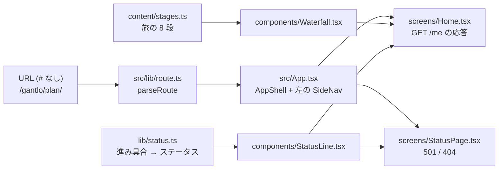

# gantlo

**API と HTTP の基礎を、問題を解きながら学ぶ学習サイト。** 学ぶコースと期間を選ぶとガントチャートで計画し、進捗はブラウザにだけ残します。

サイト: https://maco165.github.io/gantlo/

名前は、ガントチャート (Gantt) と、1969 年に ARPANET で最初に届いた 2 文字「lo」から取りました。管理の歴史と通信の歴史を、1 つの名前で指しています。

## 見せ方

サイト全体を 1 本の HTTP のやり取りに見立てます。画面を見るたびにステータスコードとヘッダーに触れるので、見ること自体が復習になります。

| 場面 | 見せ方 |
|---|---|
| ホーム | `GET /me` への応答。進み具合はステータス (`202` まだ / `206` 途中 / `200` 全部済み) で、記録はレスポンスヘッダーの形で読む |
| リクエストの旅 | 開発者ツールのウォーターフォール。URL を打ってから画面が出るまでの 8 段を、階段の帯で並べる |
| まだ無い画面 | `501 Not Implemented` |
| 知らない URL | `404 Not Found` |
| メニュー | 左。PC では常に出し、スマホでは左から開く引き出し |

見た目は Meta のデザインシステム [Astryx](https://github.com/meta/astryx) の **Gothic** テーマ (`@astryxdesign/theme-gothic`) です。暗い画面だけのテーマで、飾りの見出し文字は英字にだけ使います。

## 作り



| ファイル | 役目 |
|---|---|
| `src/lib/route.ts` | URL の道から画面を決める。# は使わない (検索エンジンが # の後ろを別のページとして扱わないため) |
| `src/content/stages.ts` | 旅の 8 段の正本 (名前・役目・主な公式文書・何週目か・帯の長さの比) |
| `src/lib/status.ts` | 進み具合を HTTP のステータスにする。どのステータスにも日本語の説明を付ける |
| `src/styles.css` | Astryx の部品で作れない所 (ステータス行・帯・ヘッダーの行) だけ。色はテーマのトークンだけを使う |
| `scripts/spa-fallback.mjs` | `dist/index.html` を `404.html` に写す。画面ごとの HTML を書き出すまでの間、どの道から開いても画面が出るようにする |

## 使い方

```bash
npm ci
npm run dev     # 手元で開く
npm test        # vitest
npm run build   # dist に書き出す
```

`main` にマージすると、GitHub Actions が GitHub Pages に配ります (`.github/workflows/deploy.yml`)。

開発用の依存の `playwright` は、今はどの script からも使っていません。それでも入れているのは、vitest の任意の依存の先にあり、無いと npm の依存の解決が `Cannot read properties of null (reading 'edgesOut')` で落ちるためです (npm 9.2・10.9.2 で再現)。画面のテスト (e2e) を足すときに使います。

## まだ無いもの

レッスンと問題、進捗の保存、計画のガントチャート、復習、用語集、画面ごとの HTML の書き出しは、これから作ります。メニューには「準備中」と出しています。

## ライセンス

MIT
